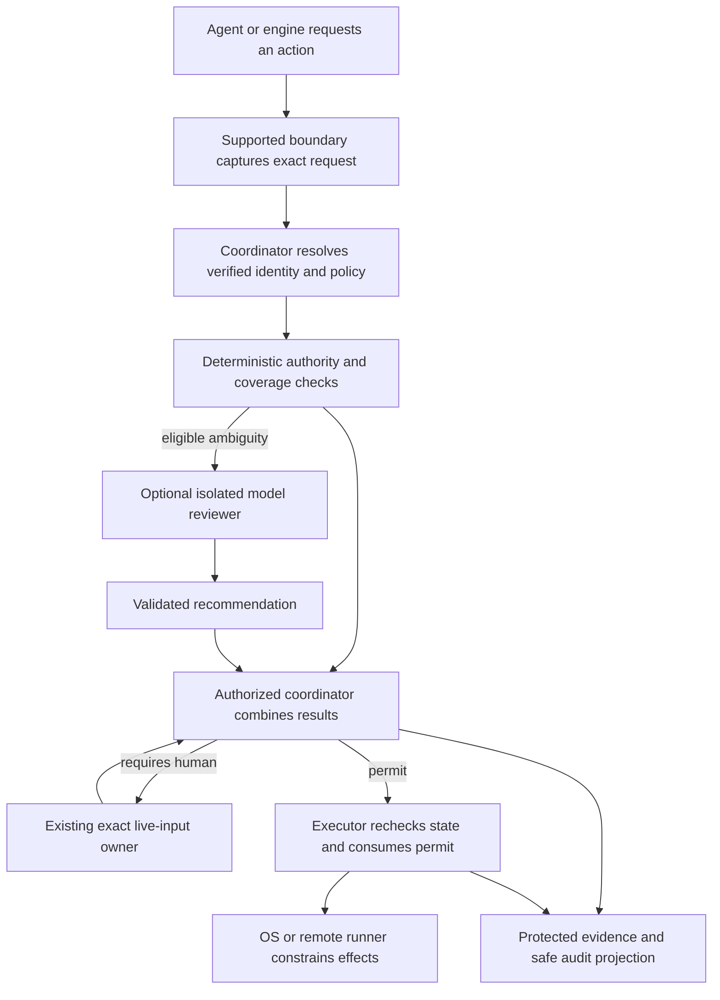

# Recommended architecture and execution semantics

This design adds implicit review around execution. Explicit `decision` and `gate`
nodes still express business choices: accept a design, choose a release target,
request revision or route a workflow. Their output is not a tool permission. A
release decision can select a deployment branch while the eventual deployment
still requires exact-action authorization. See the [baseline](current-state.md).

## Responsibilities and trust boundary

Place pure action/policy/outcome types and deterministic composition in `@orca/core`.
`@orca/agents` normalizes adapter-specific requests and implements interception at
the concrete callback/host boundary. `@orca/engine` owns a review coordinator port,
run/step/lifetime binding, policy provenance and grant consumption under the existing
lease. `@orca/daemon` supplies verified principals, current authority and authenticated
human/policy mutation endpoints. `@orca/store` reuses protected execution records and
public projections. `@orca/protocol` describes safe summaries and capabilities;
the app continues importing only protocol/design workspace packages.

Use dependency-injected ports, as existing `AgentSession`/`AgentHost` do. A model
reviewer is a replaceable client behind a narrow port, not an ordinary privileged
agent in the workflow. It receives no tools, credentials, policy-write access or
executor capability. A deterministic coordinator alone can create a permit, and
the concrete executor alone can consume it. Inbound MCP/ACP clients cannot create
permits by sending fields that resemble internal authority objects.

The trusted computing base includes ORCA, policy loading, the adapter/runner when
its self-report is relied upon, and the OS/remote host. A compromised daemon account
with access to policy and execution storage is outside what this layer can contain.
Put untrusted plugins in a separate process/runner before claiming protection from
them; an in-process extension can otherwise bypass a JavaScript wrapper entirely.

## Outcomes and composition

| Outcome | Meaning | Enforcement result |
| --- | --- | --- |
| `allow` | Evidence satisfies the applicable rules; still conditional on current authority, required coverage and state | Coordinator may issue a scoped permit; executor revalidates it |
| `deny` | A rule or authorized human rejects the action | No permit; record concise reason; do not retry with a more permissive checker/profile |
| `require-human` | Action is within authority but needs this person's confirmation | Open or reuse one exact live approval request |
| `indeterminate` | Missing attributes, unsupported semantics, policy failure, checker timeout/malformed output or unresolved state | Never maps to automatic allow; human review if permitted and meaningful, otherwise hold/fail |

A checker recommendation is separate from `effectiveOutcome` and `authorizedBy`.
Combine in this order: current authority and administrator denials; required coverage
and valid material; deterministic action restrictions and legacy deny; mandatory
human classes; bounded delegation eligibility; optional model recommendation; final
human confirmation where required. A model allow cannot remove any earlier condition.
A model denial can stop the attempt or require an authorized human review within
policy; an explicit reviewed override must be recorded, never a silent failover.

When a model is required by the selected profile, its failure blocks that lane.
When it is advisory, separately authorized deterministic operations may proceed
without it because that is the declared policy, not a fallback invented after failure.
The audit must distinguish advisory-unavailable from reviewed-and-allowed.

## Exact action envelope

Snapshot the immutable request before awaiting policy, a model or a human. Reject
duplicate JSON keys at raw transport framing where ORCA controls the parser; an ACP
callback receiving already-parsed parameters cannot recover keys its SDK discarded.
At that seam bind the canonical parsed request, mark raw-key validation unsupported
and refuse profiles requiring it unless the transport supplies the guarantee. Reject
type confusion, unsupported encodings and unbounded inputs at normalization. Retain
raw bytes privately only where available and necessary; use versioned typed-field
encoding for binding to the actual dispatch. Do not collapse shell strings to a
guessed equivalent command or trim meaningful argument bytes.

The private envelope and digest bind at least:

- Action ID, adapter request ID, tool/operation/schema version, exact arguments,
  executable/interpreter identity, shell mode, stdin/script/content digest and known
  environment/credential **references** with versions; no secret in public hashes.
- Verified initiating principal and authority generation, run/root/step/attempt,
  daemon boot, agent/session/turn/invocation identity, host and runner identity.
- Repository and worktree identity, workspace/store identity, physical cwd, all
  resources/destinations and the declared effect envelope.
- Captured policy/compiler/profile digests, current policy/revocation epoch,
  adapter coverage evidence, relevant mutable state and time/budget limits.

Relevant state is action-specific: file preimage or stable handle for overwrite,
script/lockfile/config/hook digest for a recipe, expected local/remote Git OID for
push, deployment plan/artifact/environment version, DNS/redirect checks at connection
time. A title and truncated `agent.update` args are display data, not the envelope.
Unknown attributes stay explicitly unknown; the model cannot fill them with authority.

Store exact sensitive fields in the existing protected store only when needed for
binding/recovery. Use opaque public IDs or a protected keyed digest; a public hash
of a low-entropy secret can leak it through guessing. Approval UI loads an authorized,
sanitized projection and indicates omitted sensitive fields. If redaction removes
information needed to judge the action, request a structured safe alternative or
block; do not treat the omission as evidence of safety.

## One-shot and bounded grants

Default to a one-shot permit consumed by the original invocation. A permit names
the action digest and relevant state, all identities above, issue/expiry times,
maximum uses (one), authorizer and policy epoch. Keep it internal to the owner or
make it an authenticated, replay-protected handle if a remote runner needs it.
A correlation ID alone is never an authorization capability.

A future bounded session grant is a separate explicit delegation: exact operation
templates/resources, initiating principal, run tree/session/runner, environment,
deadline, maximum calls/concurrency/bytes/spend and revocation epoch. Recheck each
action and atomically debit shared counters. Do not grant by a human-readable command
prefix, whole tool name or arbitrary `execute` in a cwd. Child processes inherit the
runner's smaller capabilities, not the ability to mint ORCA grants; child runs share
the original budget. Changing adapter mode, model-driven tool selection or agent
identity cannot widen the grant.

An approval of `git push origin HEAD:refs/heads/review` against expected remote OID X
is not approval of a force-push, a different remote/ref, a different commit or the
same text after remote state changes. Even identical text rerun later gets a new
invocation. Reusing analysis of equivalent requests is distinct from reusing a permit.

## State machine and concurrency

Proposed lifecycle: `requested → evaluated → awaiting-human? → authorized → consumed
→ completed | failed | execution-unknown`, with terminal `denied`, `expired` and
`cancelled` paths before consumption. A recommendation is not `authorized`; a recorded
human answer is not proof of execution; successful callback delivery is not proof
of the resulting effects.

Keep model calls and human waits outside the lease mutation mutex while the existing
lease keeper remains active. Lock only the authoritative validate/accept/consume
transitions; long-running review or execution must not prevent cancellation or
revocation from being observed.

1. Register the exact callback before publishing the request, preserving existing
   `LiveHumanInput` ordering. Single-flight duplicate transport requests with the
   same identity/digest return the existing state; same ID with changed bytes is
   rejected and audited. Fresh attempts always get new identities.
2. Human answer acceptance rechecks responder authority and original run authority
   inside the existing ownership mutex, then compare-and-swaps the pending state.
   The first valid answer wins; late/conflicting answers show already-settled state.
   Policy/target identifiers supplied by a caller must match server-owned records.
3. Before releasing execution, verify current authority, lease, deadline, budgets,
   policy epoch and relevant state. A change requires reevaluation/new approval;
   an old answer cannot approve a changed request. Record accepted authorization
   durably, then atomically consume the permit under the owning boundary.
4. Bind the executor's actual dispatch bytes to that consumed permit. Brokered I/O
   should use stable handles, conditional writes and remote preconditions where
   possible. Merely rechecking a filename does not close a symlink race. General
   shell execution needs containment because not all future inputs can be frozen.
5. Cancellation, lease loss, original-principal revocation, owner/agent death, turn
   end and expiry invalidate unused permits and pending approvals. Cancellation
   after dispatch is a best-effort stop with an observed termination result, not a
   promise that external effects were undone. Report unknown effects honestly.

Do not claim an atomic transaction spans an event append and an arbitrary external
effect. Crash after consume but before result is `execution-unknown`; reconcile
using an executor/service idempotency key or authorized inspection. Never blindly
replay a non-idempotent command because its completion record is absent. Duplicate
human submissions can return a recorded receipt without dispatching again.

Preserve the existing standing-write failure boundary: an answer can be recorded
while policy persistence fails, but the tool must remain unapproved/parked and
requires a fresh invocation on resume. Durable workflow gates remain recoverable;
expired live callbacks do not. Review evidence can survive restart without making
the old callback or permit reusable. Cross-process forwarding remains unsupported
until an authenticated owner-routing protocol exists.

## Unattended operation and failure budgets

An unattended profile is delegated authority with finite scope and expiry, not
`auto-approve`. Admission verifies a known runner, available required checkers,
current principal, clean isolated root-attempt workspace where required and the
approved recipes/limits. External publishing uses a separately scoped executor.

On escalation, publish one safe attention item and hold only for a bounded period
within the original callback lifetime. If a person cannot arrive in time, cancel
that invocation and pause/fail the workflow according to its declared policy.
A later resume creates a new invocation and review. It does not persist a live tool
callback as a durable business gate. UI disconnection has no authority effect.

Proposed initial tuning targets, to benchmark rather than promise: deterministic
evaluation p95 below 10 ms excluding durable I/O; model timeout 3 s with at most one
transient retry inside a 5 s total review deadline; 3 checker failures in 60 s open
the circuit for 60 s; human wait no longer than 5 minutes or the remaining turn
deadline, whichever is shorter. Installation caps bound per-run calls, tokens, spend,
queued asks and concurrency. Use monotonic elapsed time locally; remote permits need
bounded clock-skew rules and expiry validation at both ends.

Malformed/oversized/contradictory output, unknown labels, untrusted policy IDs and
late responses become indeterminate. Network/service retries use the same review
identity without creating another approval; execution retries use fresh invocation
identity. Denial does not trigger checker shopping. Deduplicate exact pending asks;
after a configurable small repeated-denial limit, stop the step with an actionable
reason. Do not let the agent loop forever on cosmetically changed rejected commands.

Cache deterministic evaluation only with versioned input/policy equivalence. Model
advice may be cached briefly only when exact action semantics, relevant state,
principal envelope, policy/reviewer versions and sanitized context match. Omitted
attributes invalidate positive caching. Never cache human approvals as decisions
for a later invocation; never skip current authority checks, state validation or
budget debits. Share no cache across principals/projects by default.

## Unified experience and audit

Reuse Attention and inline permission cards, `inputs.list`/answer handling and run
timeline; show whether an item is an execution permission or a business decision.
Show requested operation, safely rendered arguments/cwd/resources, run/agent/host,
coverage level, policy revision and matched rule, outcome, concise reason, expiry,
and authorizer (deterministic profile, delegated grant or verified person). A checker
label/model is separate from who authorized execution. Show unsupported, expired,
already answered, owner unavailable, answer recorded but not delivered and
execution unknown as distinct states. Do not advertise an "always" promise the
daemon cannot persist and enforce.

Mobile/Watch surfaces should show safe summaries and direct the user to fuller
context for complex actions. Push notifications contain opaque IDs and a generic
request-for-attention, not commands, secret paths, credential-bearing URLs or approve
capabilities. Fetch current authorized state before answering; signed-in identity,
target workspace/boot and exact action still need validation. UI text from agents
must be escaped and labelled as untrusted, never rendered as trusted instructions.

Extend existing protected execution records with structured evidence: action identity,
policy/rule versions, coverage attestation, recommendation, effective outcome,
reason code plus short safe explanation, evaluator/model/prompt version, latency,
usage, actor/grant identity, acceptance/consumption/result timestamps and result
receipt. Persist authorization evidence before releasing a permit; audit failure
blocks enforcing execution. Existing fire-and-forget `agent.permission` telemetry
is insufficient for this stronger promise. Do not store private model reasoning,
raw prompts/responses by default, tokens, full secret-bearing arguments or sensitive
notification bodies. Restrict access and set explicit retention/backup policies;
the current protected store has no automatic retention or key rotation.

Minimize reviewer context at source: structured operation attributes and necessary
bounded snippets only. Repository files, tool arguments/results, comments, remote
content and checker responses are all untrusted. Redaction is defense in depth,
not taint tracking. Treat checker egress as its own approved data destination, with
an agreed retention policy; the action's network permission does not authorize
uploading its context to a model provider.
