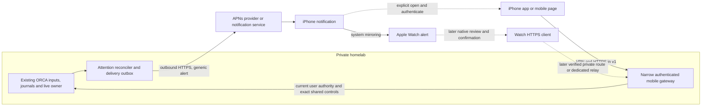

# Apple Watch alerts and remote approvals

**Draft research/design for Casey and Cal, 2026-10-03.** This proposes work; it
does not enable notifications, enroll devices, create credentials or authorize a
deployment. No runtime changes or new issues accompany this document.

## Recommendation

Start with **generic Watch alerts and authenticated review on the iPhone**.
Use Pushover for a small alert-only pilot if its privacy/vendor tradeoff is
acceptable. Then build a thin ORCA iPhone companion and a narrow approval gateway,
reusing ORCA's existing authorization, exact input identities and continuation
receipts. A mobile web review page is a viable lower-maintenance alternative to
the iPhone client; decide between them before implementation, rather than building
both. The companion is the preferred long-term path if Watch decisions remain a
goal, because it also owns native enrollment, protected credential storage and
eventual watchOS pairing.

The first remote-decision version should handle **explicitly supported durable
workflow gates on the phone**. Show the exact decision and consequence; offer
record-only or a separately explicit answer-and-continue operation where ORCA
supports it. Keep live tool permissions alert-only initially. Add a native Watch
review/confirmation screen only for an allowlist of low-risk, bounded decisions
after the actual inherited Watch passes hardware tests. Do not put immediate
Approve/Reject buttons in v1 lock-screen notifications.

Three different promises must stay separate:

| Promise | What establishes it |
| --- | --- |
| Notice an approval request on Watch | Best-effort notification delivery and the user's routing/Focus settings; no assurance it was seen |
| Review and answer on iPhone | An authenticated app/page reaches ORCA, rereads the current request and submits an explicit decision |
| Securely answer on Watch | A tested native interaction, enrolled device and current user authority, exact request checks and server-confirmed outcome; mirroring alone is insufficient |

The inherited Watch model and OS are unknown. No device, network, APNs or delivery
test was performed for this research. Platform claims below come from official
documentation checked on 2026-10-03; designs and acceptance requirements are our
recommendations, not claims of implemented behavior.

## ORCA baseline and overlap inventory

Inspected repository head: `dc30b5f9e8afa75d62f5dd8e1e76723d2f8fae4e`
([#446](https://github.com/cschadewitz/Project_Orca/pull/446)). Reviewed
[architecture](../../ARCHITECTURE.md), [development](../../DEVELOPMENT.md),
[roadmap](../../ROADMAP.md), [issue planning](../../../CONTRIBUTING.md), current
protocol/daemon/engine sources and live open/relevant closed issues and PRs.
The roadmap and early checkpoint paragraphs contain historical statements: source
and later integration evidence take precedence. Integrated main is not proof of
a distributed release, actual-Cal acceptance or deployed homelab configuration.

| Existing foundation / issue | Inspected state and reuse | Mobile-specific gap |
| --- | --- | --- |
| [#162](https://github.com/cschadewitz/Project_Orca/issues/162), [#161](https://github.com/cschadewitz/Project_Orca/issues/161), merged [#253](https://github.com/cschadewitz/Project_Orca/pull/253) | Closed; [Electron alerts](../../../packages/app/src/main/alerts.ts) coalesce attention tiers, with immediate permission alerts, 60-second gate delay and opt-in preferences. Attention already answers inputs. | Desktop notifications do not become APNs notifications. A daemon-owned sender must work without an open Electron window; reuse tier semantics and generic content. |
| [#151](https://github.com/cschadewitz/Project_Orca/issues/151), [#241](https://github.com/cschadewitz/Project_Orca/issues/241), [#294](https://github.com/cschadewitz/Project_Orca/issues/294) | Closed stream/reconnect/snapshot work; [event fold](../../../packages/daemon/src/notifications.ts), [subscriptions](../../../packages/daemon/src/subscriptions.ts), [live invalidations](../../../packages/daemon/src/live-input-notifications.ts). | Streams are wakeups, not a durable mobile delivery queue. Reconcile authorized pending state after missed events/restart; do not copy the snapshot-overwrites-newer-event bug. |
| [#328](https://github.com/cschadewitz/Project_Orca/issues/328), [#318](https://github.com/cschadewitz/Project_Orca/issues/318) | #328 remains open; #318 is closed. Token authentication, operation/resource guards, credential lifecycle and target identity are integrated via [#371](https://github.com/cschadewitz/Project_Orca/pull/371)/[#397](https://github.com/cschadewitz/Project_Orca/pull/397). | Mobile enrollment, per-device revocation and a deliberately smaller HTTPS facade. No second principal model. |
| [#237](https://github.com/cschadewitz/Project_Orca/issues/237), merged [#383](https://github.com/cschadewitz/Project_Orca/pull/383)/[#397](https://github.com/cschadewitz/Project_Orca/pull/397) | [Live input continuity](../../live-input-continuity.md) distinguishes durable gates from original-process ACP callbacks. | Do not reconstruct an expired callback from a push or turn it into a durable gate. Owner availability must be reread. |
| [#327](https://github.com/cschadewitz/Project_Orca/issues/327), [#331](https://github.com/cschadewitz/Project_Orca/issues/331), [#356](https://github.com/cschadewitz/Project_Orca/issues/356), merged [#415](https://github.com/cschadewitz/Project_Orca/pull/415) | [Operator mutations](../../../packages/daemon/src/operator-mutations.ts) delegate to shared controls; [continuation schemas](../../../packages/protocol/src/continuation-admission.ts) carry CAS boundaries and durable retry receipts. | Mobile transport must preserve these envelopes. Answer-only/live calls do not already have the continuation service's retry receipt. Revision composition remains desktop-only in the initial mobile scope. |
| [#443](https://github.com/cschadewitz/Project_Orca/issues/443), open [#448](https://github.com/cschadewitz/Project_Orca/pull/448) | Known continuation settlement race remains open at inspection. | Fix and strict acceptance evidence are a hard gate for mobile answer-and-continue; neither alerts nor answer-only research needs that fix. |
| [#338](https://github.com/cschadewitz/Project_Orca/issues/338), [#339](https://github.com/cschadewitz/Project_Orca/issues/339), [#399](https://github.com/cschadewitz/Project_Orca/issues/399) | Store/conformance, SQLite and retention follow-ons. Existing file locks and protected journals are usable foundations. | Define a contained delivery-outbox contract under these owners; no mandatory SQLite migration or new authoritative approval ledger. |
| [#363](https://github.com/cschadewitz/Project_Orca/issues/363), [#340](https://github.com/cschadewitz/Project_Orca/issues/340), [#357](https://github.com/cschadewitz/Project_Orca/issues/357) | Sensitive projections, operations/history and broader recovery ownership. | Allowlisted mobile content, delivery health and receipt correlation; no duplicate general dashboard/recovery project. |
| [#391](https://github.com/cschadewitz/Project_Orca/issues/391)–[#393](https://github.com/cschadewitz/Project_Orca/issues/393), merged [#446](https://github.com/cschadewitz/Project_Orca/pull/446) | Private MCP access has its own audience, supervised service and dedicated service-principal design. | It is not a generic mobile endpoint, mobile identity provider or per-human audit proof. Do not reuse its credential or assume phone/Watch routing through it. |

### Coordinate with triggered workflows

Read the [triggered-workflow architecture](https://github.com/cschadewitz/Project_Orca/blob/codex/triggered-workflows-proposal/docs/preparation/triggered-workflows/architecture.md)
and [#449](https://github.com/cschadewitz/Project_Orca/issues/449)–[#454](https://github.com/cschadewitz/Project_Orca/issues/454).
The [3 October decisions](https://github.com/cschadewitz/Project_Orca/issues/449#issuecomment-5974260915)
supersede its older human-only/local-only introduction: enrolled human and
review-agent feedback, including Casey's shared identity, and separately scoped
publication of tested fixes to the existing PR branch are the approved direction.
Source forms, cross-trigger serialization and expected-head publication contracts
remain unresolved; main merge stays separate. Those decisions do not authorize
implementation or live activation.

This proposal consumes the **same ORCA attention/input facts** once trigger-created
runs exist. External source intake/checkpoints stay with #450/#451, trigger routing
and admission with #452, constrained execution/publication with #449/#453 and
trigger recovery visibility with #454. A notification sender cannot admit a run,
answer a gate or expand a TriggerBinding. In particular, trigger principals still
lack `inputs.answer` and `permissions.grant`; Casey's verified human authority is
separate from their execution authority.

Agree shared correlation, versioning, bounded storage and redaction conventions
with #338/#450 and external-effect ownership with
[#350](https://github.com/cschadewitz/Project_Orca/issues/350). An outbound alert
record is delivery bookkeeping, not an external source event or second workflow
bus. Notification acknowledgements never feed back as approval or trigger events.
Mobile work need not wait for the entire trigger cohort; fixtures can use existing
ordinary gates. No trigger issues are edited by this PR.

## Platform choices

| Option | Alert / phone review / Watch decision | Pros | Restrictions and long-term cost |
| --- | --- | --- | --- |
| Native iPhone app, mirrored notifications | Alert: yes. Phone review: native UI. Watch decision: technically possible via a mirrored background action executing on iPhone, but excluded initially. | Controlled enrollment, Keychain, deep links and confirmation; no watchOS app needed for alerts. Best foundation for later Watch client. | Mac/Xcode, signing, APNs sender, OS testing and distribution upkeep. Phone dependence and small notification UI make immediate approval unsuitable. |
| Native watchOS companion, later independent networking | Alert and an authenticated Watch review screen; direct HTTPS decision possible. | Can reread state and display a real outcome on the wrist. | Separate UI, device identity, token lifecycle and testing. Independent delivery/networking must be proved on physical hardware; no background daemon socket. |
| Mobile browser / Home Screen PWA | Phone review: yes. Home Screen Web Push can mirror to Watch. Secure custom Watch decisions: not established. | Web deployment, no native signing; useful fallback phone UI. | HTTPS/session/CSRF and subscription upkeep; installation and user permission required for iOS Web Push. Do not promise a standalone watchOS PWA or actionable web notifications. |
| Pushover | Mirrored alert and supplementary phone URL; no verified ORCA Watch approval contract. | Fastest low-maintenance alert pilot; own native app/APNs implementation unnecessary. | Vendor sees delivered metadata/content; phone page still needed for approval. Notification acknowledgement is not a workflow decision. |
| ntfy | Hosted/self-hosted alerts; current iOS docs support view/HTTP action buttons. Watch action support not established. | Open source and adapter portability. | Native iOS instant delivery still involves upstream/APNs and fetching own-server content; self-hosting adds upkeep and reachability requirements. HTTP buttons do not establish ORCA user consent. |
| Pushcut | Explicit paired-Watch web-request actions; phone automation features. | Can prototype a non-authorizing Watch interaction without Swift UI. | A webhook secret is not per-user/device approval. ORCA freshness, authentication and confirmation semantics are unproved; do not configure an Approve webhook as the security boundary. |

Apple automatically forwards iPhone notifications without a watchOS app. An active,
unlocked iPhone normally gets the alert; otherwise the on-wrist unlocked Watch is
preferred. This is not a promise both alert. iPhone background pushes are not
forwarded. [Apple overview](https://developer.apple.com/documentation/watchos-apps/notifications),
[forwarding rules](https://developer.apple.com/documentation/watchos-apps/taking-advantage-of-notification-forwarding).

For actions, **background handlers run on the notification's original target**;
an iPhone push mirrored to Watch invokes the iPhone handler. Foreground actions run
where tapped; a Watch tap does not automatically open the iPhone app. The phone
must be opened explicitly or through a separately implemented/tested handoff.
Register categories on each targeted app. Supported Watches can use Double Tap
for the first nondestructive action: make that action Review, never immediate
Approve. `authenticationRequired` requires unlocking, not fresh ORCA authorization.
[Apple actions](https://developer.apple.com/documentation/watchos-apps/adding-actions-to-notifications-on-watchos),
[authentication option](https://developer.apple.com/documentation/usernotifications/unnotificationactionoptions/authenticationrequired).

Apple's support guidance requires the paired iPhone on and online for third-party
push on a cellular Watch, even if distant. Developer documentation separately
supports direct watchOS APNs registration from watchOS 6. Treat mirrored operation
as phone-dependent; make phone-off direct notification delivery an explicit
hardware acceptance gate for an independent app, not a promised workaround.
GPS-only Watch can use suitable Wi-Fi; cellular needs compatible hardware, carrier
and plan. iPhone VPN reachability proves nothing about Watch reachability.
[Away from iPhone](https://support.apple.com/en-us/108300),
[direct Watch notifications](https://developer.apple.com/documentation/watchos-apps/enabling-and-receiving-notifications),
[cellular setup](https://support.apple.com/en-us/119601).

Use ordinary HTTPS `URLSession` on Watch. Raw TCP/streams and
`URLSessionWebSocketTask` have watchOS restrictions that the simulator may not
enforce. Foreground time is limited; background transfers can be deferred.
Neither a persistent WebSocket nor silent pushes make a reliable approval inbox.
[TN3135](https://developer.apple.com/documentation/technotes/tn3135-low-level-networking-on-watchos),
[foreground requests](https://developer.apple.com/documentation/watchos-apps/making-default-and-ephemeral-requests),
[background requests](https://developer.apple.com/documentation/watchos-apps/making-background-requests).

### Web and service evidence

iOS/iPadOS 16.4 added Web Push for Home Screen web apps, with user-interaction
permission requests, paired-Watch display and no Developer membership requirement.
This proves the alert path, not custom approval buttons on Watch. WebKit requires
visible notifications rather than silent background work. Declarative Web Push
(iOS/iPadOS 18.4+) improves display fallback but adds no approval authority.
[WebKit Web Push](https://webkit.org/blog/13878/web-push-for-web-apps-on-ios-and-ipados/),
[Declarative Web Push](https://webkit.org/blog/16535/meet-declarative-web-push/).

Pushover documents Watch mirroring and supplementary URLs. Its emergency receipts
mean notification acknowledgement, not approval. TTL cleanup on iOS may lag, so
an old alert must still fail current server checks. Current individual pricing is
US$4.99 once per receiving platform, 30-day trial and 10,000 messages/month included.
[Watch support](https://support.pushover.net/s1-pushover/knowledgebase/default/c5-iphone-ipad-apple-watch),
[API](https://pushover.net/api), [pricing](https://pushover.net/pricing).

ntfy's current [action documentation](https://docs.ntfy.sh/publish/#action-buttons)
supports iOS view/HTTP actions; do not rely on older claims that all iOS actions
are unavailable. For instant native iOS notifications, self-hosted ntfy forwards
a wake-up through ntfy.sh/Firebase/APNs, then the phone fetches content from the
private server; missing access can produce a generic fallback. Without upstream,
delivery can be delayed for hours. Use authenticated topics/ACLs, not an obscure
topic name as authorization. Free/self-hosted and paid hosted tiers exist; verify
regional/current fees before choosing.
[iOS path](https://docs.ntfy.sh/config/#ios-instant-notifications),
[hosting/pricing](https://ntfy.sh/).

Pushcut documents Watch web requests, server actions and HomeKit, but not opening
Safari/Shortcuts/other apps on Watch. This is transport capability, not evidence
of protected ORCA enrollment and exact-request consent. Its current Pro pricing
is US$1.99/month, $17.99/year or $39.99 lifetime; an optional automation-server tier
is separate and unnecessary for a simple remote HTTP adapter.
[Notification behavior](https://www.pushcut.io/support/notifications),
[pricing](https://www.pushcut.io/).

### Signing, delivery and maintenance

Casey's existing paid individual Apple Developer membership is enough for a
personal native prototype. Standard membership is US$99/year or local pricing;
it is already an ongoing cost, not a new membership requirement. Individual App
Store distribution uses the developer's personal name. No reviewed Apple source
established a separate per-push APNs fee; budget sender hosting/operations instead.
[Membership](https://developer.apple.com/support/compare-memberships/).

Development/ad hoc builds need registered devices and provisioning; Apple limits
registration to 100 devices per product family per membership year. Plan signing
renewal and custody; never put signing private keys or APNs provider private keys
in app binaries or this repository.
TestFlight simplifies iteration but builds expire after 90 days and external
testing can require review. Its current install requirements include iOS 16+ and
watchOS 9+, which may rule out the inherited Watch. A stable App Store release
avoids the beta-expiry cycle but adds review, privacy/support and release work.
[Devices](https://developer.apple.com/help/account/devices/devices-overview),
[ad hoc](https://developer.apple.com/help/account/provisioning-profiles/create-an-ad-hoc-provisioning-profile/),
[TestFlight](https://developer.apple.com/help/app-store-connect/test-a-beta-version/testflight-overview/),
[current TestFlight requirements](https://beta.itunes.apple.com/).

All choices retain OS/network delivery limitations. Native clients add Mac/Xcode,
device and SDK maintenance; a web client adds browser/session maintenance; a vendor
reduces client work while adding price, privacy and availability dependence. A
native Watch adds another client lifecycle and hardware test matrix. Relay/domain,
VPN and optional carrier costs depend on choices still to be made. Do not promise
zero operating cost or a delivery SLA.

## Proposed architecture

These are responsibilities, not a requirement for multiple servers. Keep the
daemon's RPC/socket private. V1 can colocate a small gateway/sender with ORCA and
make **only the narrow gateway** reachable over an approved private VPN from the
iPhone. APNs/provider alerts arrive over the device's internet path even when
the phone's private review route is unavailable; display that distinction.
A read-only pilot sender needs no inbound connection or mutation credential.

For native push the provider runs server-side and sends to APNs with the enrolled
app/environment-specific device token. APNs does not require publicly exposing
the homelab daemon. With a vendor, the vendor owns its APNs path. Choose one first;
keep an adapter seam to migrate without changing approval semantics. Keep APNs
provider keys, vendor application secrets and ORCA user credentials in distinct
stores/scopes; notification credentials must not authorize decisions.

If private VPN review is unsuitable, a later public HTTPS gateway/relay is a
separate security/operations decision. Prefer an outbound homelab connector with
a fixed workspace mapping and allowlisted mobile messages; no arbitrary URL
proxying, raw JSON-RPC passthrough or remote shell. Relay requests must reach the
current authoritative service before reporting acceptance. Do not queue offline
approval commands for automatic future execution. Decide whether the relay is a
trusted token verifier or merely forwards end-to-end authenticated requests; this
affects key custody, audit and compromise scope and must be frozen before building.

The existing [private MCP service](../private-mcp-access/service-supervision.md)
uses an OpenAI product audience and a limited service identity. It is not the
mobile network or human identity solution. Reusing deployment supervision patterns
is reasonable; reusing the tunnel, audience or service token is not this proposal.
Notifications must run while the desktop is closed, so the actual ORCA deployment
needs supervised availability. #392's service preparation is related evidence,
not proof an appropriate daemon is currently running.

### Delivery and reconciliation

Consume `input.opened`, `input.answered`, live invalidations and relevant run changes
from the existing stream, then reread authorized current inputs. Live invalidations
are ephemeral, without a replayable `seq`; reconnect requires a current input read.
Per-run `seq` is not a global ordering across runs. Notifications can be absent for changes made
by another process; startup, reconnect and bounded server-side reconciliation
must converge against the authoritative pending list. This is delivery recovery,
not renderer polling or a second source-event system.

Persist a minimal outbox with schema version, workspace/run/step/request identity,
lifetime, revision/correlation, recipient enrollment, tier, expiry, attempt state
and provider message ID. Deduplicate by recipient plus exact request/revision/tier;
keep retries bounded with backoff, capacity limits and explicit unhealthy status.
Define durable publication/cursor boundaries and repairable indexes with #338.
Do not mark an alert sent before outbox durability, or mark an input answered from
delivery state. Lost provider responses can cause duplicate visible alerts; there
is no end-to-end exactly-once display promise.

Use coalescing to avoid floods, retain every pending request in the authenticated
inbox and keep mobile opt-in/preferences separate from desktop focus detection.
Begin with the existing tier timing; do not assume desktop focus means Casey is
present. Before retrying, reread pending state and suppress obsolete messages.
Best-effort withdrawal/replacement cannot remove every already displayed alert.
Bounded periodic recovery may recover durable asks; a brief live callback can
expire before any notification arrives and must not be resurrected.

APNs `apns-expiration` limits stale delivery attempts and collapse identifiers can
coalesce presentation, but neither is a replay defense. APNs acceptance is only
provider acceptance. Silent/background pushes are low priority, can be throttled
and are not reliable; use visible alerts and explicit app-open reconciliation.
[APNs request semantics](https://developer.apple.com/documentation/usernotifications/sending-notification-requests-to-apns),
[background delivery](https://developer.apple.com/documentation/usernotifications/pushing-background-updates-to-your-app),
[delivery diagnostics](https://developer.apple.com/documentation/usernotifications/testing-notifications-using-the-push-notification-console).

## Authentication, enrollment and approval contract

### Identity and device lifecycle

Use ORCA's existing verified principal, operation grants and resource guards.
[Current scopes](../../../packages/daemon/src/auth/principal.ts) are root-workflow
allowlists plus `runs:owned`/`runs:all`, **not an exact-run allowlist**. A separate
mobile principal with `owned` would not automatically see runs started by Casey
or a trigger. Prefer separately revocable mobile credentials mapped to Casey's
verified principal with explicit selected-workflow grants. Cross-owner trigger
runs may need `all` within those workflows; Casey must accept that envelope or
scope refinement belongs with #328. Never silently use an owner preset.

Proposed enrollment is a short-lived, single-use challenge approved from an
already authenticated owner session. Show workspace, human principal, requested
device and grants on both sides. Bind the challenge to the device's generated
key/credential, not just possession of a QR/link. Existing credential issuance and
revocation remain authoritative; the new enrollment record links user, device,
credential ID, app identity, push token/environment, policy version and revocation
state. An APNs token is a delivery address, never identity. Reinstallation/token
rotation updates the authenticated registration; it cannot silently enroll a new
approver. iPhone and native Watch eventually get separately revocable credentials.

For the personal native prototype, a reviewed bridge can deliver a dedicated,
finite-lived, narrowly scoped ORCA credential into protected device storage after
enrollment. Do not ship bootstrap tokens, export the owner's token or treat a
caller-supplied actor string as identity. For wider distribution, prefer an
established identity provider with Authorization Code + PKCE and external browser
login, mapping verified issuer/subject to ORCA; this is new integration, not an
existing OAuth feature. Validate issuer, audience, expiry, redirect and scope;
use refresh rotation/revocation and no embedded client secret.
[Native OAuth guidance](https://www.rfc-editor.org/info/rfc8252/),
[OAuth security BCP](https://www.rfc-editor.org/info/rfc9700/).

The gateway must revalidate device and user authority on every read and mutation.
The mobile contract also requires revalidation under the shared acceptance fence.
Live answers and continuation already have current-authority hooks, but legacy
durable `answerOwned` receives actor metadata rather than a current-authority
callback. `operator.answer` checks before and after delegation; a post-write
refusal cannot undo an answer accepted during a revocation race. **M3 must extend
and verify durable answer-only enforcement**, including device revocation, before
enabling that mobile path. Gateway policy
may narrow existing grants, never enlarge them. In particular, an optional
`runs.control` grant is exposed only through approved continuation operations,
not cancellation, lease breaking or arbitrary resume. Credentials used for
notification generation need only the approved read projection; no approval
credential is sent to a vendor or APNs.

Lost-device handling revokes the device's sessions/refresh/ORCA credential and push
registration, including existing connections; remote wipe is supplementary.
User revocation disables all that user's devices. Unpairing is not proof of
server revocation. Use device-bound, non-migrating protected storage appropriate
to the selected OS, require passcode/wrist detection for Watch eligibility and
reauthenticate after loss/re-pair/account change. Shared devices get alerts only,
not authority inferred from physical possession. Approvals already durably
accepted remain historical facts after revocation; later execution follows current
ORCA authority/recovery rules, not an invented rollback.

### Narrow API: proposed facade, existing authoritative services

The following route names are illustrative, **not existing ORCA endpoints**:

| Facade operation | Contract and backend |
| --- | --- |
| `GET /mobile/approvals` and `GET /mobile/approvals/{opaqueId}` | Bounded, authorized pending/current projection. Return exact workspace/boot/run/step/request/lifetime, allowed option IDs and consequences, current revision guard, server time/expiry, supported operation and safe explanation when unavailable. No raw config, logs or secrets. |
| `POST /mobile/approvals/{opaqueId}/decision` | Verified user/device plus exact reviewed identity, revision and option; decision-only delegates to `operator.answer` with durable `resume:false`. Live, if enabled later, passes all seven exact live fields. |
| `POST /mobile/continuations` | Explicit answer-and-continue or continue-only intent delegates to `operator.continueRun`/`runs.continue` with the existing `{command, retry}` shape and actual `expectedBoundary`. No detached answer-then-resume sequence. |
| `GET /mobile/operations/{id}` | Authorized status lookup using existing receipt/answer evidence; never resumes work. Reconciliation that can dispatch is a separately explicit action, not a GET. |
| Enrollment/rotation/revocation routes | Separate administrator/device lifecycle permissions; no workflow action possible merely from opening an enrollment URL. |

GETs, link previews, notification dismissal, provider acknowledgements and opening
a page have no side effects. Use TLS, request/body bounds, rate limits and safe
error projection; for browser sessions use Secure/HttpOnly/SameSite cookies,
origin checks and CSRF protection. Deep links are non-authorizing locators on a
fixed trusted origin, never tokens or arbitrary redirect targets. Validate the
authenticated target before showing details, including after connection switches.

Bind every decision to workspace, daemon boot where required, exact run,
`stepRunId`, human-input `requestId`, lifetime, selected current option and the
revision of the **decision-relevant** presentation. Do not confuse this input ID
with a top-level ORCA Request. A proposed opaque revision binds question/options,
policy, pinned workflow/generation and relevant boundary evidence, not unrelated
stream output. If any meaning changes, require fresh review. This guard is
correlation/CAS, never authority; constructing one in the client is forbidden.

Existing durable input IDs/steps are immutable targeting foundations. For supported
continuations, reuse the server's `expectedBoundary` CAS. Answer-only lacks a
general presentation-revision CAS: the facade must either prove that every
decision-relevant field is immutable for the exact identity, or extend the shared
answer service to validate a revision under its existing ownership fence. A
gateway pre-read followed by an unchecked write is not sufficient. Freeze this
contract with #237/#328 owners before enabling mobile writes.

Live decisions require all of `runId`, `stepRunId`, `requestId`, `instanceId`,
`sessionId`, `turnId`, `invocationId` from
[LiveDecisionTarget](../../../packages/protocol/src/live-input.ts). Reused tool-call
IDs do not identify a new callback safely. The original owner checks lifetime and
execution authority; daemon restart, cancellation, lease loss or turn expiry makes
the old action unusable. Only offered one-time options are permitted. No mobile
standing rules or `always` answers; `permissions.grant` remains separate.

Inputs are not universally binary: empty offered options can mean free text.
Such inputs are not Watch eligible. A declared corrective branch such as Request
changes must use #356's protected revision payload/destination contract; it cannot
be submitted as an ordinary Reject option. The initial mobile decision API refuses
it and directs the user to the existing desktop revision flow; a later phone
revision composer would be separately scoped work.

### Duplicate responses, uncertainty and execution

The run's existing fence/CAS accepts at most one valid answer. Concurrent phone,
Watch and desktop answers must return the winner or a conflict without executing
the loser. A delayed response must not act on the next request, changed workflow,
new boot or new invocation. Check authorization before exposing stale/private
diagnostics, and again at the authoritative write boundary.

For answer-and-continue, retain the exact command and idempotency key before send
and reuse the existing protected retry/continuation receipt. A repeated key with
different content conflicts. Acceptance is restricted to currently supported
sealed **root durable** boundaries; live callbacks, child/ancestor continuation,
uncertain pauses and missing generations are unsupported. Do not fall back to
legacy long-running `inputs.answer` with implicit resume, which is unsuitable for
mobile background execution limits. #443 must be resolved and verified first.

For answer-only/live there is no equivalent existing retry receipt. An explicitly
scoped experimental stage may send once, retain non-secret intent correlation and reconcile through authorized
exact answer evidence after a timeout; if evidence is incomplete, show **Outcome
unknown — check on phone/desktop**, not success or an automatic resend. This is
not completed M4/M5 write-MVP acceptance and does not enable live phone approvals.
Before releasing phone commands, shared M3/P3 work must provide durable command
receipts and authorized non-mutating lookup by original client intent even when
the first response loses the server receipt ID. Attach correlation atomically to
the existing shared answer journal/fence; a gateway cache must not become a
second acceptance ledger.
Do not regenerate an idempotency key to bypass an ambiguous operation.

On disconnect, keep a draft only. An offline tap cannot approve, and reconnect
must fetch fresh state and ask for renewed confirmation before any new send.
An already-sent uncertain operation is checked read-only using its original
identity. Expiry uses server time; client clock and APNs TTL cannot extend it.
Notification outbox replay may resend an alert, never a decision.

Keep the UI and audit vocabulary precise:

1. **Alert sent**: provider accepted a notification; not proof of display or consent.
2. **Approval/rejection recorded**: exact decision is durable. Record-only may leave
   the workflow parked. Reject is the offered workflow outcome, not necessarily
   cancellation, and can itself have consequential routing.
3. **Continuation accepted / execution resumed**: show these separately, only from
   authoritative receipt and execution evidence. An accepted receipt can remain
   blocked; a live answer may be recorded without successful callback delivery.
4. **Work completed/failed**: comes from authoritative run outcome, not a green
   checkmark on the notification or an HTTP 200 from a relay.

Audit verified principal, device/credential ID, exact target/revision, option,
server timestamps, original operation/receipt and result/refusal. Preserve the
existing actor event, protected rationale and retention rules. Delivery attempts
and device enrollment/revocation are separate audit facts. Never put bearer tokens,
tool arguments, private rationale, raw push tokens or protected payloads in public
logs; access to audit details is authorized too. A device event cannot prove which
person held an unlocked shared device, so do not claim that assurance.

## Human factors and policy

Default payload: **“ORCA needs your review.”** Use opaque correlation and, at most,
an explicitly permitted count. Commands, paths, prompts, diffs, credentials and
sensitive repository names stay behind authenticated review. Locked Watch can
show notification summaries; Apple provides summary/full-content controls, but
ORCA must not rely on users finding the perfect settings.
[Watch privacy settings](https://support.apple.com/en-us/108369).

V1 notification actions are Review/Dismiss only. Dismiss does not reject. A future
Watch flow opens a fresh summary naming action, target, scope and consequence,
then requires a distinct confirmation. Neither default action, Double Tap nor
accidental screen contact may immediately authorize work. Marking Reject
destructive visually is useful but not authorization. Never truncate essential
context into a decision; say **Review on iPhone** when it does not fit.

Watch eligibility is a server policy allowlist over pinned, understood operation
semantics, never a label supplied by an agent or approval prose. Candidate examples
are bounded local test reruns or a non-destructive gate with fully visible scope;
even these require review of what that workflow's next step can actually do.
An apparently harmless gate before deployment is not low risk.

Escalation does not expand the receiving device's supported actions. Publication,
merge, deployment, standing grants, enrollment/security/configuration changes,
secret administration and revision composition remain owner/desktop operations
in the initial mobile scope, as defined by the [iPhone companion draft #461](https://github.com/cschadewitz/Project_Orca/pull/461). The phone may show a safe desktop pointer, not authorize these operations.
Only phone-supported actions, such as an allowlisted durable choice or explicit
cancel, can escalate to fresh phone confirmation; insufficient evidence, spending,
arbitrary destructive changes or large/unclear diffs require desktop review. Low-risk rejection is not assumed:
escalate it too when rejection releases claims, discards work or routes elsewhere.
Some actions remain outside the mobile API entirely. A biometric/device-unlock
check supplements current server authorization; it never replaces it.

## Phases and proposed issue-sized slices

These are draft slices, not filed issues or release commitments. Use the existing
[feature template](../../../.github/ISSUE_TEMPLATE/feature.md), retain metadata on
related work, and select one primary ship group per eventual issue. Proposed
groups are `ship-group:mobile-alerts`, `ship-group:phone-approvals`, and later
`ship-group:watch-approvals`; names require triage, no labels/milestones are created.

| Slice / phase | Outcome, scope and acceptance | Foundations; hard dependencies | Non-goals |
| --- | --- | --- | --- |
| M0 — device and route feasibility | Record exact paired hardware/OS, distribution choice and threat/identity decisions; test synthetic alert routing and private phone HTTPS access with iPhone/Watch Low Power Mode independently on/off in a separately authorized experiment. Accept only a written capability matrix with failures retained. | No code blocker. Uses Apple evidence; hardware and later setup authorization required for actual tests. | Real approval, credentials/deployment in this research PR; broad platform support. |
| M1 — durable attention delivery | Daemon-owned reconciliation/outbox plus one Pushover adapter for generic alerts, or APNs if native is selected immediately. Prove duplicate/restart suppression, missing-stream convergence, expiry, bounded retries and redaction with fake provider. | Existing #151/#162 semantics, #338 storage seam. Contract alignment with #450; completing #450/#339 is not a blocker. | New event bus, workflow admission, action callbacks. |
| M2 — mobile identity and restricted gateway | Enrollment/revocation and exact human mapping; bounded read-only inbox over chosen private route. Prove no cross-user/workspace access, no owner fallback and revocation on active sessions. | Integrated #328/#318; M0 identity/route decision. Coordinate #363 projections. | General daemon proxy, tunnel reuse, OAuth platform from scratch. |
| M3 — shared exact-decision boundary | Validate answer-only presentation revision/immutability and current user/device authority under the shared fence; extend the legacy durable path where needed. Preserve exact answer and uncertain-result semantics. Expose supported durable decisions through gateway. Prove stale/concurrent/revocation/lost-response cases and protected actor audit. | M2, integrated #237/#327; coordinate narrowly scoped #328 contract work. | Alternate approval ledger, live permission enablement, standing grants. |
| M4 — iPhone review client | Native inbox/enrollment, safe deep links, Review-only mirrored notifications, server-confirmed record-only outcome and explicit unknown state. Choose mobile web instead only as an agreed scope substitution. | M2/M3; M0 hardware/distribution. M1 needed for alert-integrated acceptance, not UI fixtures. | Watch decision UI, background RPC, both native and web in one slice. |
| M5 — explicit durable answer-and-continue | Preserve `{command,retry}`, expected boundary, status lookup and separate resume/completion states; prove single decision/execution and restart/lost-ack recovery. | M3/M4; existing #331/#356 services; **#443/#448 correction and strict acceptance**. | Child/live/unsupported continuation or automatic mutation retries. |
| M6 — native Watch low-risk review | Enroll a distinct device, fetch/confirm an allowlisted decision via HTTPS, and show truthful receipt. Test accidental taps, stale screen, expiry and concurrent phone decision on physical Watch. | M0/M2/M3/M4; M5 only if Watch offers continuation. Exact live support, if later desired, is another bounded extension. | Consequential actions, “always”, universal callback support. |
| M7 — independent connectivity and operations | If phone-off use is still needed, verify direct APNs/HTTPS and dedicated relay/private route, revocation, outbox health, upgrades and signing expiry; document the supported hardware matrix. | M6 and separate topology/security decision. Related #392 supervision, #340/#357 visibility/recovery. | Treating iPhone VPN as Watch VPN or promising offline approvals. |

**One shared implementation with [companion #461](https://github.com/cschadewitz/Project_Orca/pull/461):**
M2 maps to P1 enrollment/revocation and restricted projections; M3 maps to P3
authority/revision fences and receipts; M4/M5 consume P2/P4 phone surfaces and
commands. Native APNs delivery under M1 is N1, sharing the same daemon-authorized
enrollment, token lifecycle and outbox, counted once. P5a gates a read-only pilot;
P5b gates command release with physical-device/security/accessibility/signing/
privacy/support evidence. M4/M5 send-once/unknown experiments cannot bypass P3
receipt/recovery acceptance or claim the completed write MVP. Watch escalation
never expands the phone action allowlist.

Smallest rollout: M0/M1 for awareness; M2–M4 for phone decisions; M5 only after its
existing blocker is resolved; M6/M7 only if use justifies maintenance. The
Pushover pilot can be replaced by native APNs without changing M3. M1 and M2 can
proceed independently after contracts agree; phone/Watch fixtures can develop
against frozen schemas while services are built. Final acceptance follows the
real integrated services, not mocks.

Hard dependency order is acyclic: `M0 → M2 → M3 → M4 → M5`, with `M1 → M4`
for alert integration, `M4 → M6 → M7`, and optional `M5 → M6` only for Watch
continuation. M1 has no M0 implementation dependency when using a fake provider;
real hardware acceptance does. Existing integrated contracts are prerequisites
already present, not demands to close their entire parent issues. #443 is an
external unresolved gate for continuation. Full trigger execution, SQLite,
general secret catalogs (#335–#337) and actual-Cal #393 are related, not mandatory
dependencies of mobile alerts/phone review. Recheck live inventory before filing.

## Test and acceptance matrix

No tests below have been executed by this documentation change. Future
implementation needs focused unit/protocol tests, real daemon/file-store failure
fixtures, required repository checks and physical Apple hardware evidence.

| Area | Required cases and observable pass condition |
| --- | --- |
| Delivery/routing | Phone unlocked/locked/offline/off/distant; Watch locked/off-wrist/Focus; iPhone/Watch Low Power Mode independently on/off, paired phone nearby/absent and Watch network-using app closed/opened; notification permission denied; apps backgrounded/terminated; GPS Wi-Fi and cellular where available. Record which device alerts and latency distribution/misses, not an SLA. No silent-push dependence. |
| Queue recovery | Duplicate, delayed, out-of-order/lost pushes; provider 429/5xx/timeouts and invalid tokens; daemon/sender restart at every persist/send/checkpoint boundary; desktop closed and other-process writes. Every still-pending durable request is discoverable by authenticated reconciliation; capacity saturation is visible; no mutation follows delivery. |
| Exact identity | Wrong workspace/boot/run/step/request/option; stale revision, replaced gate, changed pinned generation, replayed invocation, expired callback and unavailable owner. Zero effect; current authorized explanation without leaking another user's data. |
| Races/durability | Phone versus Watch versus desktop approve/reject; revocation during submission; lease loss; crash after decision before response; continuation settlement race; truncated/corrupt/missing protected evidence. One winner, preserved original receipt and explicit conflict/unknown; no second execution or fabricated success. |
| Authentication | Enrollment replay/expiry/QR theft, wrong key/audience, expired/revoked device, rotated credentials, changed human scope, shared/lost device and wrong target after reconnect. Unauthorized reads and writes fail; no actor spoofing, owner fallback or broad RPC access. |
| Offline/lifecycle | Offline tap sends nothing later without fresh confirmation; an uncertain already-sent intent retains its exact identity for status read. Watch re-pair/reinstall, APNs token/environment rotation, server reboot and expired TestFlight/provisioning never silently restore authority. |
| UI and privacy | Lock-screen payload and logs contain no sensitive request data or tokens. Review is first/default action. Double Tap/accidental tap/dismiss never decides. Full consequence visible before confirmation; high-risk or unsupported input directs to phone/desktop. Test VoiceOver, readable text and both approval and rejection. |
| Status/audit | Provider acceptance, decision recorded, continuation accepted, execution resumed and terminal result are demonstrably distinct. Rationale stays protected; device/user/target/operation correlate across retries. Notification acknowledgement cannot alter workflow state. |
| Independent Watch | If claimed, phone off plus real Watch Wi-Fi/cellular must pass direct notification, auth, HTTPS, revocation and uncertain-response tests on each supported model/OS. Simulator-only evidence is insufficient. |

Apple documents that Watch Low Power Mode disables Wi-Fi/cellular data while the
phone is absent until a network-using app opens. Retain delayed/missed alerts and
foreground recovery observations; no delivery guarantee follows from this matrix.
[Apple Watch away from iPhone](https://support.apple.com/en-us/108300).

Record exact code head, app build/distribution channel, Watch/iPhone models and OS,
power modes, battery condition, network state, server build, test method and retained failures. Fault tests use
synthetic requests/providers before any live enrollment. A later supervised pilot
may measure prompt-to-alert and tap-to-receipt latency with synthetic gates, but
never reduce server freshness checks to make delivery appear reliable. Suppressed
or missed alerts leave desktop/phone inboxes as the authoritative fallback.

## Decisions Casey and Cal must make

1. **Hardware and use case:** Watch model/generation, GPS or cellular, installed and
   maximum watchOS, battery condition and previous-owner unpairing/Activation Lock;
   iPhone model/iOS and pairing compatibility; ordinary personal pairing versus
   Family Setup. Use Apple's [compatibility matrix](https://support.apple.com/en-us/118490).
   Is the phone normally carried, left on elsewhere or powered off? Is outdoor
   cellular necessary, and with which region/carrier/plan?
2. **First client:** Pushover awareness pilot followed by native iPhone (recommended),
   or mobile web review/PWA to minimize native maintenance? Is native Watch approval
   still needed after trying alerts? Who has a supported Mac/Xcode and owns builds?
3. **Authority:** Which ORCA human principal and root workflows may mobile inspect
   and answer? Is workflow-scoped `runs:all` acceptable for trigger-created work?
   Which exact semantics qualify for Watch, including rejection? Which operations
   must always require phone/desktop and fresh authentication?
4. **Network/trust:** Private iPhone VPN first, or a separately reviewed relay? Who
   operates it, holds provider keys and handles outages? Is vendor visibility of
   generic alert metadata acceptable? No assumption about existing homelab routing
   or the MCP tunnel resolves these choices.
5. **Lifecycle/privacy:** Notification tiers, quiet hours, generic versus opt-in
   previews, sharing/passcode policy, revocation procedure, audit/intent retention,
   signing channel and tolerated renewal work. Choose a budget for hosting, service
   fees, carrier and ongoing device testing.
6. **Implementation gate:** Agree exact revision/receipt ownership with existing
   approval maintainers, #443 acceptance for continuation, and outbox correlation
   with triggered-workflow owners before authorizing slices. No issue creation,
   implementation, credentials, deployment or live notifications follow merely
   from publishing this research PR.
