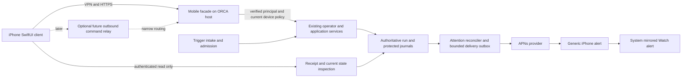

# Companion architecture and command security

This is the proposed architecture for the [iOS companion research](README.md), using its exact source baseline. Proposed routes and fields below do **not** exist merely because this document names them. The authoritative services already exist in part; mobile enrollment, projections, several command guarantees and APNs delivery still need implementation and acceptance.

## Components and ownership

These boxes are logical boundaries, not a requirement for separate servers. Prefer the mobile facade in the daemon process or a tightly coupled host module so it calls the same authorization and fenced services. If deployed as another process, forward verified per-device authority over a protected internal interface; do not replace it with an owner/service identity and a caller-provided actor header. The phone never runs an agent, interprets workflows or writes ORCA storage.

Within the phone, keep `OrcaWire` (typed JSON and conformance), `HostSession` (identity, credentials and foreground connections), `SnapshotStore` (bounded protected cache), `CommandClient` (confirm, persist, send, inspect) and `NotificationRouter` (untrusted hint to authorized fetch) separate from SwiftUI features. This allows network/receipt tests without rendering and keeps future Watch/client adapters on the same wire semantics.

| Owner | Responsibilities | Explicit boundary |
| --- | --- | --- |
| iOS companion | SwiftUI screens, URLSession transport, authenticated enrollment UX, Keychain, minimal cache, retained intents, foreground recovery, accessible confirmation and phone handoff | Cannot infer authority, fabricate revision guards or accept a command while offline |
| Shared daemon contract work | Device-linked authorization, mobile-safe projection, exact command identity/revision, receipts and current-authority checks under existing fences | Reuse auth/admission/control journals; no second approval engine or gateway acceptance ledger |
| Watch and notification proposal [#459](https://github.com/cschadewitz/Project_Orca/pull/459) | Notification enrollment binding, APNs credentials/provider/outbox, privacy policy, delivery health, mirrored routing, physical Watch tests and later watchOS interaction | Notification receipt or gesture is never an approval; count this work once across both projects |
| Trigger cohort [#449–#454](https://github.com/cschadewitz/Project_Orca/issues/449) | External event intake/checkpoints, enrollment policy, batch admission, enforced execution/publication profile and trigger recovery | Phone consumes resulting run/attention facts. It neither owns a trigger event bus nor edits/activates TriggerBindings in v1 |
| Host/operator | HTTPS/VPN route, supervision, enrollment/revocation and recovery access | Home power/ISP failure cannot be fixed by APNs or an app |

The existing Watch draft was reviewed and its record-only phone-first contract is adopted here. Direct agent alignment is pending Kepler's cross-task message confirmation; the split is a proposed shared boundary until acknowledged. The mobile work does not wait for all triggered-workflow work: ordinary existing gates are adequate fixtures. Trigger principals lack `inputs.answer` and `permissions.grant`; a verified human may have different authority over the same run. Shared GitHub identity is not proof of a trusted human action.

## Connectivity choices

Use **installed Tailscale on iPhone plus host HTTPS** for the first private pilot, assuming Casey and Cal accept a second app and eligible network membership. Restrict VPN access to the mobile gateway port. ORCA still authenticates every call. Current non-loopback daemon deployment checks require token authentication and a trusted TLS reverse proxy; a VPN is not an exemption. See [transport validation](../../../packages/daemon/src/auth/transport.ts).

| Model | Operations and approximate incremental cost | Reliability | Security and fit |
| --- | --- | --- | --- |
| LAN HTTPS | Existing host/network; certificate and setup work | Works at home; no away-from-home access | Useful setup/fallback, not the remote MVP. Explicit local-network permission/denial UX. |
| Tailscale plus HTTPS | Personal plan may be $0 for eligible non-commercial use; two Standard users $16/month at current list price | Direct or encrypted DERP fallback; depends on VPN state, home host and network. Another VPN can interfere with On Demand | Recommended pilot. Network identity supplements ORCA authority; least-privilege network policy. No assumption Watch inherits phone VPN. |
| Existing self-managed VPN | Low incremental hosting if already operated; otherwise reachable endpoint/relay and administration | NAT/CGNAT, dynamic addresses and mobile transitions need operator handling | Viable if already proven. Key rotation, peer removal and routed LAN exposure belong to operator. |
| Public HTTPS reverse proxy | Domain/TLS, patching, rate limits and monitoring; roughly $10–30/year domain allowance plus host costs | Direct URL without VPN; needs reachable ingress or an outbound tunnel. Home outages remain | Expose only authenticated mobile routes; protect origin from bypass, do not publish unrestricted `/rpc` or `/socket`. More Internet attack surface. |
| Managed outbound tunnel and identity edge | Cloudflare Tunnel avoids public origin IP; Access Free under 50 users or listed $7/user/month annually on paid tier | Vendor edge and home connector are dependencies; easier NAT handling | Viable alternative after native login/refresh spike. Provider terminating TLS can see traffic. No shared Access service secret in the binary. |
| Dedicated outbound ORCA relay | Proposed service; budget $10–30/month for modest compute/storage/backups, plus engineering and on-call | Works behind CGNAT; relay can show host offline, cannot execute while host is down | Best eventual integrated setup. Authenticate device and host separately; restrict routes, tenants, payloads and expiry. Higher breach blast radius and operational burden. E2EE requires separately reviewed key/recovery design. |

Official anchors: [Tailscale connection types](https://tailscale.com/docs/reference/connection-types), [pricing](https://tailscale.com/pricing), [iOS VPN On Demand](https://tailscale.com/docs/features/client/ios-vpn-on-demand), [Cloudflare Tunnel](https://developers.cloudflare.com/tunnel/), [Access pricing](https://www.cloudflare.com/en-gb/sase/products/access/), [service tokens](https://developers.cloudflare.com/cloudflare-one/access-controls/service-credentials/service-tokens/), [Apple local-network privacy](https://developer.apple.com/documentation/technotes/tn3179-understanding-local-network-privacy). Hardware/domain/relay allowances are estimates, not quotes. Tailscale's current Personal plan permits six users and non-commercial use; verify eligibility rather than assuming a product team qualifies.

The [OpenAI private MCP bridge](../private-mcp-access/service-supervision.md) has a distinct workspace audience, MCP transport and dedicated service principal. It supplies neither a documented general iOS HTTPS endpoint nor human/device enrollment. Do not reuse its key, audience, service token, availability assumptions or cost allocation. A future mobile relay is a separate capability decision.

APNs and command relay are independently replaceable. A host can send outbound APNs requests while phones reach commands through VPN; there is no requirement to proxy commands through the notification provider. Prefer APNs provider credentials on the supervised host for the single-host pilot if Casey accepts custody there. A shared broker later keeps those credentials off every homelab, at the cost of a service and recipient-mapping trust boundary. Never put APNs provider keys in the app. Do not durably queue commands at a relay in v1: forward to a reachable host and reconcile uncertain delivery against that host.

Choose ORCA-topic and environment-specific APNs keys where supported, isolating unrelated apps on Casey's personal account; rotate/revoke through the notification owner. [Apple key creation](https://developer.apple.com/help/account/keys/create-a-private-key/), [token-based APNs](https://developer.apple.com/documentation/usernotifications/establishing-a-token-based-connection-to-apns). For pilot HTTPS, prove a trusted reverse proxy using a managed `ts.net` certificate or another trusted certificate with an explicit renewal owner. Tailscale certificate issuance exposes machine/tailnet DNS names through Certificate Transparency, so use nonsensitive names. No certificate is provisioned by this research. [Tailscale HTTPS](https://tailscale.com/docs/how-to/set-up-https-certificates).

## Identity and device lifecycle

Existing [credential storage](../../../packages/daemon/src/auth/credentials.ts) supports finite credentials, rotation and revocation; [principals](../../../packages/daemon/src/auth/principal.ts) separate stable user identity from credential ID. Scope is a root-workflow allowlist plus `runs:owned` or `runs:all`, not an exact-run allowlist. Do not copy an owner/operator/client preset: each is broader than a phone's intended authority in some respect.

Proposed enrollment uses a short-lived, single-use challenge created by an authenticated owner/administrator. QR or manual code carries the trusted endpoint, workspace identity and pairing reference, never a reusable admin credential. Phone generates a device key; the owner verifies the requested human principal, device and grants and binds consumption to that public key. Reject reused/expired grants, wrong endpoint/audience, key substitution and concurrent consumption. Permit later remote enrollment only through an authenticated reviewed flow.

Create a separately revocable credential for that device mapped to its actual human principal. Store linkage among enrollment ID, principal, credential ID, key, expiry, policy, APNs token/topic/environment and revocation state. APNs tokens rotate and are addresses, not identity. Reinstallation, restore or unpairing does not silently create a new trusted approver. A later native Watch gets separate enrollment/credentials, not the phone's bearer token.

For a pilot, reuse finite ORCA credentials behind the narrow facade, with reviewed explicit renewal/re-enrollment. Token audience/device policy enforcement is additional work under #328; current credentials are not already OAuth refresh tokens or proof-of-possession credentials. Mobile restrictions must be enforced wherever such credentials are accepted, or network and daemon admission must make raw RPC bypass impossible. Merely hiding a button is insufficient. For wider accounts, use an established identity provider with external-browser authorization code plus PKCE, verified issuer/subject mapping and refresh rotation; do not design a homegrown OAuth server. [RFC 8252](https://www.rfc-editor.org/info/rfc8252/), [OAuth security BCP](https://www.rfc-editor.org/rfc/rfc9700).

Start with `runs.read`, selected `workflows.read` and optional `artifacts.read`. Add `runs.start`, one-time `inputs.answer` and narrowly exposed `runs.control` only after their acceptance gates pass. Deny `permissions.grant`, config/plan writes, agent spawning, maintenance and lease release. Current protocol capability `runs.control` is coarse; inspect installed methods and current operation/resource grants, not that flag alone. Selected-workflow `runs:all` may be needed to see trigger-created or Cal-owned runs; Casey and Cal must accept that visibility or fund finer scope under #328. `owned` on a new unrelated mobile principal would hide their existing work.

Store foreground command secrets with Keychain `kSecAttrAccessibleWhenPasscodeSetThisDeviceOnly` and suitable user-presence access control. Apple documents unlocked/passcode requirements, no migration to another device and deletion when the passcode is removed. Protect cached content and intent files with iOS Data Protection, exclude sensitive caches from backup, redact app-switcher previews and use bounded retention. No raw token in preferences, URLs, analytics, crash logs or WatchConnectivity. This deliberately limits locked-background command execution. [Keychain class](https://developer.apple.com/documentation/security/ksecattraccessiblewhenpasscodesetthisdeviceonly), [accessibility and presence](https://developer.apple.com/documentation/security/restricting-keychain-item-accessibility).

On loss, revoke device credentials/refresh family if any, enrollment and push registration from an independent owner session; invalidate active connections and recheck current authority under every mutation fence. VPN removal is defense in depth. Unreachable cached data cannot be remotely erased reliably: minimization, encryption, expiry and passcode matter. Revocation does not undo a decision already recorded. Later execution observes the existing execution-authority rules. Renewal of another principal's expired execution authority is not automatically granted by the ability to answer a gate; current [execution runtime](../../../packages/daemon/src/execution-runtime.ts) requires the original launching principal for explicit renewal.

Use normal certificate/hostname validation and ATS-compatible HTTPS; no accept-any-certificate switch or global ATS exception. Deliberately design certificate rotation for private hosts. A stable workspace identity binds data; daemon boot identity changes at restart and requires rediscovery. An unexpected workspace/principal change quarantines retained intents and asks for explicit enrollment review. [Apple secure connections](https://developer.apple.com/documentation/security/preventing-insecure-network-connections).

## Mobile API and reuse boundaries

Illustrative route names below describe a new versioned facade. Its handler adapters should call existing application services rather than invoke their own localhost RPC with a broad shared token. [Operator contracts](../../../packages/protocol/src/operator-mutations.ts) and [bounded reads](../../../packages/daemon/src/operator-read-model.ts) are the starting point, including current target identity and authorization-first diagnostics.

| Proposed facade | Existing service and required boundary |
| --- | --- |
| `GET /mobile/v1/session`, `/runs`, `/runs/{id}`, `/decisions` | Authenticated discovery/current grants and bounded authorized projections; omit private fields and unknown schema additions. Page revisions/cursors, explicit incomplete/omitted reasons. |
| `GET /mobile/v1/artifacts/{id}` | Both run and artifact authorization, exact artifact-to-run binding, sensitivity policy and bounded content. Current operator text cap is 16 KiB and complete result cap 256 KiB; retain explicit truncation. Mobile may choose smaller limits. |
| `GET /mobile/v1/workflows`, `POST /mobile/v1/preflight` | Read-only approved catalog/preflight. Validate typed inputs and current workflow/config generation; never implicitly start work. |
| `POST /mobile/v1/commands` | Typed allowlisted launch, decision, cancel or continuation; verified target and actor, fresh policy and exact effect boundaries. No arbitrary RPC forwarding. |
| `GET /mobile/v1/operations/{id}` | Authorized inspection only. Read existing admissions/continuations or new shared decision/cancel evidence. No repair/dispatch/implicit resume in GET. |
| Read-only operation inspection by client command ID | New required lookup for a first response lost before server `operationId` arrives. Resolve an authenticated principal/workspace/kind/client ID or scoped retry key against existing authoritative evidence without claiming a key, appending or dispatching. Do not put retry secrets in URLs/logs. Existing `admissions.get` alone cannot do this. |
| Explicit reconciliation command | When recovery can attach execution, preview and authorize it as a mutation; do not disguise `admissions.reconcile` or `continuations.reconcile` as status polling. |
| Enrollment and revocation | Separate administrator/device lifecycle authority. Opening a link, scanning QR or fetching a URL cannot approve work. |

Existing operator projections bound/omit data and redact known sensitive values; they cannot prove arbitrary artifacts contain no unknown secrets. Define a mobile allowlist of fields and artifact kinds and test canaries. Do not expose raw launch vars, config, logs, tool arguments, absolute paths, private prompts or internal errors by default. Render Markdown inertly, block embedded remote content and scripts, cap parsing work, confirm external links without adding credentials, and prevent arbitrary endpoint/redirect/SSRF selection from artifact text. Safe summaries must identify source/provenance and missing context, not invent a model-generated assurance of safety.

Foreground recovery uses snapshot plus notifications with per-run `seq`, not a global cursor. Live `input.invalidated` and store invalidations require rereads; stale leases need reads too. On app activation, reconnect, account change or sequence loss, fetch authorized snapshots and reconcile without replacing newer state with an older response. Keep an observation generation around asynchronous reads. The server notification reconciler may perform bounded recovery reads; that is not a reason for screens to periodically poll lists.

## Command identity and authoritative acceptance

The shared proposed mobile envelope contains a schema version, random command ID, target `(workspaceId, instanceId where required)`, exact resource identity, operation, selected option/typed inputs, server-issued revision/boundary, and server-bounded expiry. Bind the canonical intent to the authenticated principal, device enrollment and operation kind. Client-provided actor IDs, timestamps, hashes and notification IDs grant no authority.

For a durable decision, identify **run, stepRunId, human-input requestId and lifetime**. A human-input requestId is not a top-level ORCA Request ID. The server-issued decision revision covers question, offered options/consequences, evidence identities/content revisions, policy, workflow/generation and relevant step/attempt boundary. Unrelated log output should not invalidate a decision. Compare under the authoritative writer fence, after current credential/device/resource checks. A gateway read followed by an unchecked legacy write does not provide this guarantee.

For future live permission support, pass all existing [LiveDecisionTarget](../../../packages/protocol/src/live-input.ts) fields: `instanceId`, `sessionId`, `turnId`, `invocationId`, `runId`, `stepRunId`, `requestId`. Only the original interpreter can deliver to its callback. Restart, expiry, lease loss or cancellation makes the old target unusable. Never reconstruct it from a notification or parked log. V1 offers a desktop handoff, not delayed live answers.

| Operation | Reuse now | Gap before enabling phone writes |
| --- | --- | --- |
| Approved launch | `operator.admitRun` with `target` and strict command/retry; or `runs.admit` with `expectedScope`. Both use pinned workflow revision/version, config generation, retained idempotency key and authorized receipt lookup | Approved catalog/effect policy and mobile retained-intent client; verify root workspace safety (#460), current-authority recovery and read-only lookup before a server ID is known. Legacy `runs.start` waits too long for mobile lifecycle. |
| Durable record-only answer | `operator.answer` targets exact run/step/input with `resume:false`; engine lease already prevents conflicting answers | General presentation revision, current-authority recheck inside durable answer fence and durable command receipt. Ordinary `inputs.answer` has no retry key/revision. Attach evidence atomically to existing shared acceptance journal, not a gateway cache. |
| Answer and continue or resume | `operator.continueRun` / `runs.continue`, exact `{command, retry}`, server-issued `expectedBoundary`, protected decision-plus-dispatch marker and `continuations.get` | Include merged #448/#443 regressions, read-only recovery before receipt ID arrives, and the new presentation/effect-policy fence for any decision. Existing boundary binds workflow/config/step/attempt/request; it does not establish every proposed artifact-evidence/policy revision. Only supported root durable boundaries; no legacy fallback. |
| Cancel | `operator.cancel` verifies target and delegates existing control | Bind to reviewed run lifecycle/control revision and current authority at effect boundary; define stable cancellation receipt or honest unknown outcome and reconciliation. Report per-target/partial results: cancellation can affect children before the parent fence fails and live abort precedes terminal settlement. No atomic tree-cancel promise or retry against a newly resumed attempt. |

The durable-answer authority gap is source-inspected, not a demonstrated exploit: the legacy `answerOwned` path gets actor metadata, whereas live answers and continuation have current-authority hooks. `operator.answer` checks around the call, but a post-write refusal cannot undo acceptance during a revoke race. Extend shared control/engine enforcement and test the interleaving. See [control](../../../packages/daemon/src/control.ts), [orchestrator](../../../packages/engine/src/orchestrator.ts), [operator mutations](../../../packages/daemon/src/operator-mutations.ts).

For each explicit launch/continuation intent, durably retain the exact body and key in protected local storage **before sending**. Use ORCA's existing key/receipt shapes; do not insert invented fields into strict RPC schemas. New mobile metadata requires deliberate schema additions/adapters. Same principal/workspace/kind/key and same canonical payload returns the original receipt; changed payload conflicts. Keys are retained through uncertainty and are not regenerated to bypass a stale/conflicting operation. Expiry limits first acceptance; later authorized inspection of a previously accepted command remains possible. Retention/tombstones must prevent expired keys being treated as fresh (#399).

Phone, Watch and desktop can race. One exact pending revision wins; a later same-intent retry returns its receipt, while another command gets the authorized winner/conflict and fresh state. Do not infer ownership from a matching option string. Receipt identity, semantic input identity and transport request ID are separate. Persistent identity, canonical binding, current authority and the single-use boundary prevent replay; a UUID, APNs TTL or client clock alone does not.

Until answer/cancel receipt extensions are proven, an experimental client may send once and show **Outcome unknown** after lost acknowledgement, inspecting exact authorized evidence without resend. That is a constrained test phase, not completion of the write MVP. Do not claim answer-only already has continuation-grade idempotency.

The same caution applies when the first admission/continuation response is lost before its server ID is known. Current receipt reads need that ID. Reposting the retained command is a mutation, and continuation replay can schedule reconciliation; it is not read-only recovery. P3 must add authorized non-mutating discovery by retained client identity in the shared journal, with no second acceptance ledger. Until available, retain unknown outcome and require an explicit reviewed retry rather than silently replaying on app activation.

## Offline behavior and truthful status

No automatic offline mutation queue in the MVP. Cached views have `asOf` and an offline label; unsent intentions remain drafts. Reconnect fetches current target, authority, revision and evidence before fresh confirmation. Sent uncertain intents reconcile with their original identity. Neither background wakeups nor relays replay a user's draft hours later. A future queue is separately scoped and must define expiry, cancellation and fresh authorization; never queue live asks, standing grants or destructive controls by default.

| Displayed state | Evidence required |
| --- | --- |
| Draft, not sent | Local record only; no execution claim |
| Sending or outcome unknown | Transmission begun; no verified authoritative acceptance yet |
| Approval recorded | Durable exact decision evidence; may leave run parked |
| Continuation accepted | Durable continuation marker/receipt; execution may still be blocked |
| Execution resumed | Authoritative attachment/running evidence, separate from acceptance |
| Completed, failed or cancelled | Current terminal run evidence for the correlated run; a settled receipt alone is not success |
| Alert accepted by provider | APNs response only; not display, attention, consent or execution |

Ordinary default `inputs.answer(resume:true)` may record then fail resume and return `answerRecorded:true`; preserve that distinction. [#443](https://github.com/cschadewitz/Project_Orca/issues/443) reported `run.completed` followed by a blocked continuation receipt during replay. It closed during this research when [#448](https://github.com/cschadewitz/Project_Orca/pull/448) merged. The fix covers deterministic competing-replay and post-completion settlement-failure paths; the original CI interleaving is not claimed known. Use a mobile implementation baseline containing that fix and retain the strict regressions. Surface any future contradictory evidence for operator review rather than rewriting history from whichever response arrived last.

After this fix, a completed run can legitimately coexist with an accepted receipt when final settlement publication failed. Display completion from verified run history alongside receipt settlement pending; read-only inspection must not repair or dispatch. Explicit authorized reconciliation settles the existing receipt. This is different from falsely changing a completed run to blocked.

Audit should correlate verified human/credential/device, host/workspace, command ID, exact target/revision, canonical intent reference, acceptance/rejection, receipt and execution transitions. Protected decision evidence can retain a rationale under existing policy; operational logs expose safe IDs/codes, not token, note, input or artifact bodies. The existing auth audit queue is not an atomic acceptance ledger. Preserve durable acceptance in the existing protected journal and do not claim exactly-once external side effects or tamper-proof audit merely because a log exists. Restoring old host backups needs existing whole-store recovery rules and preserved replay tombstones.

## Confirmation and stronger authentication

Every mutation requires explicit confirmation of current host, operation and consequence. Renew confirmation after any changed revision, scope, host, account, generation, long interruption or unsent offline draft. Cancel of a run tree, costly/elevated launch, consequential approval and explicit execution-authority renewal require recent user presence and current server policy; v1 excludes high-risk catalog entries by default. User presence is not proof of server authority. Never trust an `authenticatedWithFaceID:true` field as remote step-up evidence. If policy requires verifiable step-up, use an established IdP or reviewed device-key challenge bound to this command and expiry; that service is new work.

Enrollment, scope expansion and recovery of account/device access remain owner/desktop operations. Request changes composition, broad standing permissions, publication, lease breaking and arbitrary recovery stay on desktop. A notification action, swipe, default option, GET, link preview, dismissal or handoff acknowledgement is never a confirmation.

## Shared APNs and phone to Watch contract

The notification work owns one durable bounded outbox keyed by recipient enrollment plus exact request/revision/tier. Internally it retains workspace/run/step/input/lifetime, policy, expiry and delivery attempts with existing storage owners. Consume existing attention notifications, then reread pending authority after reconnect/startup and before stale retries; per-run seq is not cross-run ordering. External-writer gaps need bounded server reconciliation. No second trigger bus, workflow admission or approval ledger.

Proposed APNs custom payload is deliberately small: `schemaVersion`, opaque `notificationId`, opaque `routeRef`, generic `category`, optional opaque `revisionHint`, `expiresAt` and localization key. The server maps routeRef to enrolled account/host/exact entity after authentication. No raw host address, repo/title, question, option, tool argument, artifact, rationale, secret, bearer token or actionable approval capability. Internal request identities need not be exposed on the lock screen. A hint is untrusted until fetched from the authenticated host.

Use the proper bundle topic, APNs environment, alert push type, bounded expiration and opaque collapse/thread identifiers. Handle token replacement, unregistered tokens, throttling, provider-key rotation and bounded backoff; revoke delivery registration when device authority is revoked. Collapse/expiry improve presentation, not semantic dedupe or replay defense. APNs is best effort and may reorder or retain only one pending notification; missing pushes are recovered by the authenticated inbox, not inferred as absence of work. [Apple APNs semantics](https://developer.apple.com/documentation/usernotifications/sending-notification-requests-to-apns), [provider responses](https://developer.apple.com/documentation/usernotifications/handling-notification-responses-from-apns).

V1 sends a generic alert and asks the user to open ORCA on the phone for review. Do not assume a tap on Watch programmatically opens the phone. Mirrored background action handlers execute on the original target; foreground actions run where tapped. Register/test categories accordingly and make any default gesture Review, never Approve. No immediate approval/rejection action in lock-screen notifications. [Watch forwarding](https://developer.apple.com/documentation/watchos-apps/taking-advantage-of-notification-forwarding), [Watch notification actions](https://developer.apple.com/documentation/watchos-apps/adding-actions-to-notifications-on-watchos).

A future native Watch handoff sends an opaque route and optional existing command correlation through WatchConnectivity, never authority or pre-consent. Phone fetches fresh details and confirms. If the same already-sent intent moves devices, preserve its command identity for inspection; independently confirmed actions are competitors against one revision. Do not let two devices recreate an uncertain action. WatchConnectivity acknowledgement means transfer, not host acceptance. Standalone/cellular access, phone-off behavior, native Watch credential storage and Watch-specific confirmation remain #459's physical-device acceptance work; phone VPN connectivity does not establish them.
