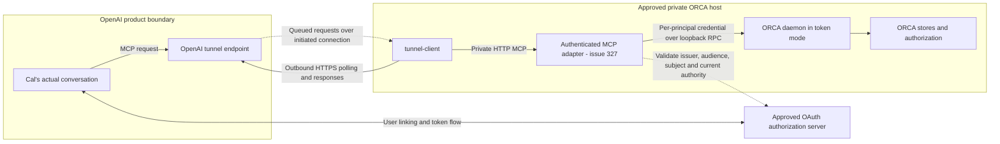

# Private MCP connection design

Proposed topology and security contract for #401, based on the source commit and dated
guidance in [decision.md](decision.md). This is an implementation target, not a deployed
configuration. Account support and the end-to-end identity chain remain unverified.

## Preferred topology

Use an authenticated HTTP MCP adapter beside the ORCA daemon. HTTP is the proposed first
transport because it provides a request boundary at which #327 can validate user tokens;
do not assume a stdio process inherits the remote user's verified identity. The precise
HTTP transport/version must be validated with the selected client release.

The external endpoint belongs to the tunnel service. Neither the raw daemon nor the MCP
adapter gains an inbound public listener. Bind the colocated adapter and daemon to
loopback; verify listeners, host firewall and target configuration during setup. The
bridge is allowed one configured adapter destination, never an arbitrary URL or shell
tool. Do not enable Harpoon HTTP callouts as an alternative ORCA interface.

If the selected bridge host cannot be colocated, the only extra edge is **bridge host →
MCP adapter host over an already approved private network/tailnet**. Limit its ACL to
the selected host/port and retain application authentication and validated TLS. Keep
adapter-to-daemon loopback where possible. No requirement for Cal to join Tailscale,
no new subnet router, Funnel, broad network membership or public fallback follows from
this design. If the daemon leg itself becomes remote, apply its trusted-TLS-proxy
contract from [daemon security](../../daemon-security.md); a VPN alone does not replace it.

## Identity chain to verify

1. The product account/workspace may use the selected tunnel. The bridge's runtime
   credential authenticates the bridge to its control plane. Neither fact identifies
   an ORCA caller or grants ORCA permissions.
2. The authenticated MCP connection proves an application user with an approved issuer
   and stable subject. #327 validates token signature or introspection, issuer, intended
   resource/audience, expiry and current revocation on every request. Reject user labels,
   model-supplied `actor` fields and unverified forwarded identity headers. The
   [official authentication contract](https://developers.openai.com/plugins/build/auth)
   is the starting point; the actual tunnel must be tested for authentication metadata
   and token preservation. No identity-header convention is assumed.
3. A server-managed allowlist binds that verified `(issuer, subject, approved target)`
   to a dedicated ORCA principal and its non-bootstrap credential. Provision the mapping
   administratively, separately from tool calls. Effective permission is the intersection
   of the MCP user's current scope and the ORCA credential's grants. If a narrower MCP
   scope cannot be enforced, refuse rather than dispatch with broader authority.
4. The adapter calls authenticated daemon RPC with that principal's credential; the
   daemon independently checks the current credential, operation and resource. Keep
   upstream OAuth tokens and ORCA bearer tokens at their respective audiences. Never
   forward an OAuth token to an ORCA endpoint that cannot validate it, or replace a
   denied caller with one shared privileged identity.
5. Mutation/decision audit records retain the daemon-verified principal and credential ID,
   target, operation and outcome. Adapter correlation may add a safe request ID; it must
   not overwrite the actor or log tokens, payloads, private paths or raw artifact content.

This mapping is a proposal for #327's supported remote authentication, **not an OAuth
implementation present in main**. No issuer or account integration has been approved.
Use an existing approved authorization server if available; needing new identity
infrastructure is a decision to return to Casey, not work authorized by this handoff.
Authorization-server endpoints must be reachable by the participating browser/product
and verifier; the tunnel does not automatically carry that traffic (see the
[official tunnel explanation](https://developers.openai.com/blog/connect-private-mcp-servers-to-openai-products)).

## Resource and operation boundary

The initial existing-run grant and its workflow-wide limitation are specified in
[decision.md](decision.md). Reuse `CredentialStore` and `Authorizer`; do not duplicate
run-root resolution or let the adapter read protected stores directly. Require the
approved non-secret target identity before any real ORCA read. The fixture has its own
test identity; it cannot prove the pending #318 daemon identity contract.

| Access class | First probe / initial inspection | Later operator work |
| --- | --- | --- |
| Target discovery | Authenticated fixed fixture identity; later #318-backed safe identity | Pin workspace/deployment identity and recheck after reconnect; never infer identity from a URL alone. |
| Run hierarchy, attempts, events | `runs.read` within approved root workflows, including existing history | Filter before counts, links, cursor results and notifications; bound content and page sizes. |
| Artifacts and workflow definitions | Explicit `artifacts.read` and `workflows.read` in the same scope | Protected/sensitive execution storage remains unavailable; follow authorized projections. |
| Request/plan links and configuration provenance | Not included in the initial grant | Current restricted scopes cannot hold `plan.*` or `config.*`. Reuse #332 safe projections and review #366 for bounded plan access; never proxy raw `config.get`. |
| Launch/preflight | Absent | Separately approved `runs.start`; preflight is side-effect-free but uses this grant on main. Request and direct launch stay distinct. |
| Cancel/resume and exact input answers | Absent | Separate `runs.control` / `inputs.answer`, current target and lifetime checks, plus explicit user intent for each action. |
| Standing rules, credentials, network/admin operations | Absent | Outside initial MCP surface. `permissions.grant` is not implied by a one-time answer. |

Tool discovery advertises only implemented, wired, authorized operations. A tool being
visible does not grant permission to act without user intent. Instructions found in run
output or artifacts are data and cannot change grants or approve another tool call.

## Revocation, reconnect and failure

Treat three credential domains separately: product/app linking and OAuth tokens; tunnel
control-plane runtime credentials; and ORCA credentials/principal mappings. Each has a
named administrator and independent revocation procedure in the
[operator checklist](operator-checklist.md). Rotating one does not rotate the others.

Revalidate both upstream and downstream authority on each call, notification delivery
and replay. On unlink, revocation or expiry, invalidate adapter sessions/caches and stop
delivery; daemon sockets already revalidate and close with 4401. Do not replay cached
protected output after access is removed. Revocation prevents further access; it does
not retroactively cancel work already admitted or erase data already returned.

After network/process recovery, verify the same target before accepting more work. Bound
backoff, buffering and response sizes; report unavailable or unknown outcome honestly.
Never retry an uncertain mutation automatically until #331's durable retry contract is
integrated and verified. A transport JSON-RPC ID or admission receipt alone is not an
idempotency key. Reconnect cannot answer a gate or resurrect an expired live callback.
