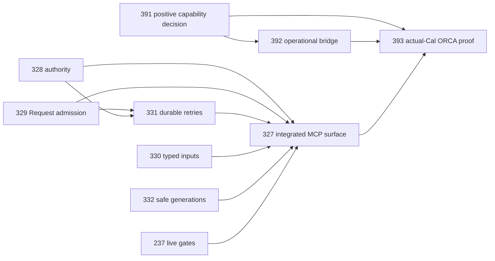

# Private MCP implementation handoff

Preparation deliverable for [#401](https://github.com/cschadewitz/Project_Orca/issues/401),
dated 2026-10-02 UTC. Exact reviewed main source:
`7abc2342aa672ee9d2f10d565ca4f8eb546184df`. `origin/main` was fetched and the worktree
synced before preparation. No peer branch was imported. This directory contains all
changes; runtime, app, workflows, manifests and access settings are outside its ownership.

## Review packet

| Artifact | Review purpose |
| --- | --- |
| [decision.md](decision.md) | Candidate route, dated official sources, observed foundation, P1–P10 unknowns and BLOCKED recommendation |
| [connection-design.md](connection-design.md) | Topology, identity chain, least-privilege existing-run grant and revocation boundaries |
| [operator-checklist.md](operator-checklist.md) | Concrete setup stages and required approvals; validation, rollback and removal |
| [acceptance-plan.md](acceptance-plan.md) | R1–R7 reference tests, C1 actual-Cal fixture gate and C2–C8 full ORCA proof |

## Foundations and inventory

Open/closed issue and PR inventory was checked on 2026-10-02 for MCP, tunnel, Cal,
scopes, credentials and runtime integration. Reuse these owners instead of filing a
second adapter, auth system or bridge story:

| Work | Observed state / implication |
| --- | --- |
| [#368](https://github.com/cschadewitz/Project_Orca/pull/368), [#371](https://github.com/cschadewitz/Project_Orca/pull/371), [#330](https://github.com/cschadewitz/Project_Orca/issues/330) | Merged authentication/runtime foundation and shipped typed validation; source evidence is [runtime integration](../../archive/runtime-foundation-integration.md). #328's open issue is not evidence that these are absent. |
| [#397](https://github.com/cschadewitz/Project_Orca/pull/397) | Open, unmerged integration of #329/#332/#318/#237. Its target identity, configuration generation and live-gate work is pending. Recheck exact main before implementation; do not import its branch or count its advertised checks as Cal proof. |
| [#327](https://github.com/cschadewitz/Project_Orca/issues/327), [#328](https://github.com/cschadewitz/Project_Orca/issues/328) | Single owners for inbound MCP and daemon authority. User mapping, safe projections and bounded existing-run inspection belong here. |
| [#391](https://github.com/cschadewitz/Project_Orca/issues/391), [#392](https://github.com/cschadewitz/Project_Orca/issues/392), [#393](https://github.com/cschadewitz/Project_Orca/issues/393) | Existing feasibility, operational bridge and actual-Cal evidence stories. This packet prepares them; it implements none of them. |
| [#331](https://github.com/cschadewitz/Project_Orca/issues/331), [#399](https://github.com/cschadewitz/Project_Orca/issues/399) | Durable client retry contract and later retention follow-up; an admission receipt is not a retry key. No automatic uncertain mutation replay before integration. |
| [#366](https://github.com/cschadewitz/Project_Orca/issues/366), [#367](https://github.com/cschadewitz/Project_Orca/issues/367) | Existing plan-scope and bounded read-model follow-ups. Do not silently add workspace-wide permissions to bypass them. |

No additional issue is needed for the current findings: the identity/provisioning/scope
decisions remain in #327/#328/#391; bridge lifecycle in #392; execution proof in #393;
bounded plan access and filtering already have #366/#367. A new per-run scope feature
would need a confirmed requirement and a fresh overlap check before issue creation.
Outbound execution-agent capabilities #335–#337 do not establish inbound Cal access.

## Implementation slices and proposed ownership

These paths are proposals for a later reviewed ownership allocation, not permission to
edit them now. Existing files linked below are actual main files; proposed directories
are not asserted to exist. Freeze exact files with the relevant owners before coding.

| Slice / owner | Proposed files and boundaries | Entry and exit conditions |
| --- | --- | --- |
| A: #391 capability probe | Proposed `tools/private-mcp-probe/` and `docs/private-mcp-access/` evidence/runbook | After separate implementation authority, build the isolated fixture and reference tests without production access. Execute C1 only after P1–P8 and setup approval. Exit with supported/blocked decision and reviewed ORCA identity mapping. |
| B: #327 adapter and identity | Proposed `packages/integrations/src/mcp/` and `packages/integrations/test/mcp/`; coordinate package exports/manifests and CLI command registration with their owners | Implement supported remote authentication, verified per-user mapping, bounded tools and protocol-based safe projections. Use #328's authority rather than raw stores. Fixtures can proceed independently; advertise only integrated operations. |
| B1: #328/#327 provisioning seam | Existing [credential store](../../../packages/daemon/src/auth/credentials.ts), [principal schema](../../../packages/daemon/src/auth/principal.ts), [CLI auth command](../../../packages/cli/src/commands/auth.ts) and their tests | Design a reviewed explicit permission provisioning path for the initial read grant. No broad preset fallback. Any finer run scope or safe linked-resource projection requires coordinated auth ownership. |
| C: #392 bridge operations | Proposed `tools/deploy/private-mcp/` templates/tests and `docs/private-mcp-access/operations.md` | Fixture lifecycle work can proceed in parallel. Deployment/acceptance waits for positive #391 and specific approvals. Exit includes revocation, restart, rollback/removal and no-public-ingress evidence. |
| D: #393 integrated proof | Proposed `test/private-mcp/` fixtures and `docs/private-mcp-access/evidence/` | Wait for #391, operational #392 and implementation-ready #327. Execute C2–C8 on exact integrated builds with Cal and approved test scope; link results to #327 without a second tool implementation. |

Do not assign a second implementation owner to daemon methods, protocol schemas,
admission, configuration generations or live-gate state. Reuse the seams in
[runtime-next parallel contract](../../archive/runtime-next-parallel-contract.md) and recheck their
integration status. The adapter consumes authenticated wire operations; it must not
bootstrap a parallel engine to bypass a daemon refusal.

## Dependency graph and parallel work

Arrows below mean a prerequisite for acceptance, not a request to close issues first.

#401 has no implementation hard blocker: unknowns are a valid preparation result.
#391's isolated fixture does not require #327. #318 target identity is a required
integration contract for the real-target checks, coordinated through #327, not a
prerequisite for the synthetic fixture. #392's reference tests, #327 adapter fixtures
and Mac preparation can proceed in parallel without peer-branch imports. The graph
is acyclic; never add #393 as a reverse hard dependency of #327. #393 supplies evidence
for #327's acceptance after its implementation is ready.

## Decisions Casey/Cal must resolve

1. Identify Cal's actual surface and target organization/workspace, verify P1–P4 and
   approve only the missing account changes. No personal identifiers are assumed here.
2. Select the bridge host, existing issuer and secret-delivery mechanism. Accept
   colocation or specify the exact existing private hop; approve P5–P8 setup separately.
3. Approve the real resource envelope: all runs of selected root workflows, or request
   a finer scope and keep existing-history access blocked. Decide the later Request/plan
   and safe configuration visibility without adding owner permissions.
4. Review the authenticated subject-to-principal mapping and revocation behavior, then
   authorize the isolated probe. Cal performs C1 in the existing conversation. Only
   verified evidence changes #391's result; this document cannot stand in for that call.

**Next implementation slice:** after review and explicit implementation authority, A's
synthetic authenticated fixture and identity-binding negative tests. Its endpoint must
have no ORCA credentials or production data. Preparing it needs no production connection;
actually linking it still needs the account/credential/network approvals in the checklist.
Do not start a persistent bridge as part of completing #401.

## Documentation verification

Before publishing the draft PR, check all five files for whitespace errors, Markdown
structure, relative paths/fragments and external source/issue links; inspect the Mermaid
diagrams and compare permissions/scope claims with the pinned code. Check that the diff
is confined to this directory and contains no secrets or personal project data. The
repository ignores Markdown in Prettier, so `format:check` alone is not a prose/link check.
Report executed checks and limitations in the PR. Runtime suites or a diagram render
cannot prove Cal support; no runtime tests are claimed by this preparation.

Use `release:none` for this documentation-only work and open a **draft** PR against main.
Only #401 is a closing reference. Link #391 and #327 as related work; their acceptance
remains open. No milestone or existing issue metadata changes follow from this handoff.
