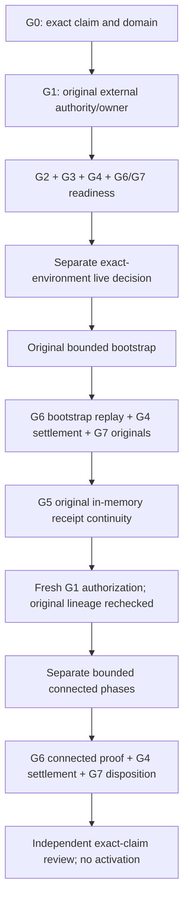

# Finite architecture gates for future observation

> Later direction decision: Casey selected a disposable Linux VM as the first
> proof domain. The [concrete VM preparation plan](current-image-linux-vm-plan.md)
> records the setup interfaces, safeguards and finite owner handoff now required.
> This resolves the domain choice below, not G0's exact-environment binding or any
> runtime gate, provisioning authority or live-run permission.

Source baseline: `f14eba992bf060320fdc8cf55db066ba327a0baf`, preparation branch
`prep/706-current-main-nonlive`, draft PR #809. This is a decision-ready architecture
contract, not an execution plan or a new permission mechanism. No runtime code,
source pin, bound, image or launch refusal changes in this increment.

## Milestone and end condition

**M0 ends when this finite gate map, whole-lifecycle ownership contract and framed
proof-scope question/options have independent review and source/evidence correspondence.**
M0 closes the planning prerequisite; it does not close any missing runtime gate.
Further isolated cleanup changes are not sufficient evidence of launch readiness.
Every later change must discharge a named exit obligation below, with remaining
dependencies explicit. A new list of small cleanup issues is not the next milestone.

The older [observation design](current-image-observation-design.md),
[qualification map](current-main-qualification-map.md) and
[early ownership inventory](current-image-early-ownership.md) remain dated evidence.
Subsequent preparation repaired constructor rollback, eligible cleanup continuation,
consumed handles and private error precedence. The latest source also captures
worker failures privately. Those changes do not establish a single owner spanning
first acquisition, ambiguous startup, every process and durable recovery.

## Established baseline and missing architecture

Established preparation includes independently rebuilt retained image bytes,
historical physical regression, current-source refusal, v2 synthetic qualification
checks and bounded independent source reviews. Recent cleanup/privacy tests exercise
inert dependencies and source correspondence; ordinary CI is separate evidence.
The four observation entry functions still refuse at their first executable statement.

Missing architecture includes a named authenticated external session issuer, a
preexisting durable recovery owner, preventive isolation before effects, actual
loaded-code closure, whole-attempt acquisition/start/settlement ownership and a
budgeted private evidence protocol. No available controller, isolation service,
evidence store or execution environment is asserted to satisfy those obligations.
No availability inspection or live qualification is performed here.

## Eight gates, with finite exit evidence

Gate readiness is a reviewed obligation, not a stored Boolean. None of the entries
below can be consumed as permission. A report, hash, CLI/environment option, JSON
object or synthetic successful callback cannot create a session or ownership.

| Gate | Required input and exit evidence | Current state / failure rule |
| --- | --- | --- |
| G0 — exact claim and trust scope | Choose the execution domain, exact claim, allowed synthetic data and threat assumptions. Name the environment owner and excluded equivalence claims. | Decision required. No implicit substitution between a guest, namespace or host. |
| G1 — external session origin | A named, independently authenticated controller already owns approval, consumption/revocation, permitted lanes and unchanged budgets for one original session: at most one bootstrap and one connected lane, each with a fresh grant check and no automatic retry. It retains original lifecycle responsibility and a private destination before delegation. Binding covers exact reviewed inputs, environment, loader policy and original session. | Missing issuer/owner contract. A candidate-authored token, signed object without an independently trusted issuer, or mutable metadata is insufficient. Lost acknowledgment refuses further effects. |
| G2 — preventive containment | The named platform owner enforces filesystem, network, process, descriptor and environment restrictions before candidate code, builders or preparatory probes execute. Candidate code cannot change its supervisor, private sink or policy. Exact inherited FDs and permitted mounts/resources are enumerated. | Not instantiated or qualified. Tracing, replay, process groups and `prlimit` do not establish this boundary. Any unavailable or uncertain protection prevents admission. |
| G3 — trusted bootstrap and loaded closure | An independently rooted minimal bootstrap is itself bound to reviewed immutable code and configuration. Its enforced loader permits only the reviewed Python/Node/native/tracer closure; actual code origin is bound before evaluation. Evidence distinguishes permitted closure from what actually loaded. | Missing trusted loader/origin. Disk hashes after import, `__file__`, child self-report or newly repinned sources cannot attest loaded code. Unsupported dynamic/native loading refuses; no ambient fallback. |
| G4 — whole-attempt ownership and private failure durability | The S0–S10 contract below is implemented as one original ownership graph. Every acquisition/start has success, failure and uncertainty handling; each borrower and disposal precondition is explicit. A reviewed schema, write ordering, retention/access policy and accounting fit unchanged bounds. | Partial local helpers only. No inference from inactive control worker, callback return or durable status to process settlement. Uncertainty retains original ownership and blocks receipt/command release. |
| G5 — original bootstrap-to-connected continuity | A real, separately authorized bootstrap has complete replay/semantics, original process settlement and sealed originals. Only its retained original supervisor/image/receipt graph can supply the internal connected association, with fresh external session authorization still valid. | No current original bootstrap or connected capability. Restart, copied artifacts, historical positive fixtures or receipt deserialization do not carry continuity. |
| G6 — complete current-source behavioral qualification | Complete original bootstrap replay precedes its receipt; complete connected replay follows the separate Save, human Allow Once and fresh rule phases. Validate authority freshness, delivery ownership, timing and closed effects against reviewed current code. | Synthetic and historical evidence is partial preparation only. Preserve Save's zero execution, separate Allow Once and fresh valid authority. No pin shortcut, partial trace or aggregate success grants permission. |
| G7 — evidence disposition and independent qualification | Before admission, the private/public schema, custody, access, retention and uncertainty protocol are reviewed. After observation, originals and bounded safe projections support independent qualification of the exact claim, with omissions explicit. | Private storage and full runtime qualification absent. Independent bounded review is not formal security approval; #779/#793/#794 remain prohibited. No merge, activation or next run follows from a report. |

The trust model must protect the host and management plane from a faulty candidate,
and protect the observer/evidence owner from candidate modification. Kernel,
hypervisor/platform and minimal bootstrap trust must be named rather than silently
assumed. Same-process cooperative source assumptions remain explicit where existing
semantic capability checks cannot independently measure JavaScript object identity.
Containment protects resources; it does not itself prove semantic authorization.

## Dependency order without an authorization cycle

G0 fixes the claim. G1 names the original trusted controller and recovery owner.
G2, G3, G4, the **prelaunch reviewed-source/checker portion** of G6 and the
**prelaunch policy portion** of G7 must then be implemented,
independently reviewed and available before any candidate effect. Their conjunction
is a requirement for the external controller, not a conjunction of user-set flags.

The permitted future sequence is:

Completed bootstrap proof is not a prerequisite for authorizing the first bootstrap:
that would be circular. The preexisting external issuer and enforced trusted
bootstrap establish its initial boundary. Loading is controlled before evaluation;
post-run measurements corroborate the actual loaded graph rather than retroactively
authorizing earlier effects. None of that trust infrastructure exists in this task.

External observation authorization and internal action capabilities are distinct.
External authorization cannot replace the original bootstrap receipt or grant tool
execution authority. A receipt cannot authorize an observation session. Preserve one
original supervisor and physical image lineage across bootstrap and connected phases
inside the chosen domain. Evidence export is permitted only under a future reviewed
policy and never exports a live capability. A guest/process restart loses that
continuity; it cannot resume from a JSON receipt.

## S0–S10 ownership, startup and evidence contract

This finite inventory covers the architectural acquisition categories visible in
the current wrappers and supervisor. It is not an implementation-complete callgraph
or proof that every transitive runtime allocation has been qualified. The next
implementation must inventory each concrete acquisition/transfer within these stages
and demonstrate the six exit properties listed afterward. The stages describe required
ownership categories and ordering, not the exact current call chronology; source/image
checks already invoke helpers before lane creation, and wrapper builds precede `observe`.

| Stage | Original owner and transfer requirement | Failure / uncertainty disposition |
| --- | --- | --- |
| S0 — outer reservation | A preexisting controller/recovery owner reserves the attempt and private destination before delegating effects; it already owns the reservation mechanism. | Failure or lost acknowledgment admits no observer. No claim that a missing journal means no attempt exists. |
| S1 — wrapper preparation | Temporary root, image preparation/build and each helper subprocess belong to an original outer attempt owner, before `observe` is called. | Constructors/factories retain unreturned resources; no unregistered child or path is abandoned as implicitly clean. |
| S2 — initial resources | Lane directory, lifetime FD/flock, independent exclusion FD and exactly four pipe pairs have registered owners before subsequent fallible work. | Partial adoption and cleanup failure retain exact ownership; no numeric FD/PID rediscovery or close retry after consumption. |
| S3 — preparation effects | Plan/witness writes, runtime snapshots, `ldd`/git/helper calls, EXITKILL checks and clock probing remain within containment and the attempt's process/artifact inventory. | Clock probing has its own process group and restoration obligations. Calling it preflight does not exempt it from ownership or authorization. |
| S4 — pre-start state | Query provenance, diagnostic constructors, originals/trace files, clocks, private holders and report allocation are completed under an owner before worker startup. | First error retained; failed persistence is separate uncertainty. No worker is started merely to obtain cleanup evidence. |
| S5 — startup/adoption | Control worker, tracer creation, subreaper state, original callback adoption and sampler startup have explicit not-started/owned/uncertain transitions and original handles. | A thrown start or missing acknowledgment does not prove nothing started. No blind restart; retain owner and prohibit command release. |
| S6 — phase release | Original leader pidfd/procfd and diagnostic adoption are owned before use. Each command preserves exact bootstrap/connected lineage and fresh authority. | No release based on readiness reports or reconstructed ownership. Incomplete adoption refuses. |
| S7 — settlement | Original process owner, control worker and sampler discharge their own obligations under unchanged bounds. Environment owner survives delegate failure. | Control-worker inactivity does not settle tracer/tracees or sampler. Preserve all still-borrowed resources and private evidence on uncertainty. |
| S8 — eligible disposal | Only resources with discharged borrowers transfer into consume-once disposal. Remaining eligible cleanup continues despite another disposal error. | Attempted close is not proved release. Never signal a reused PID/group or retry a consumed numeric descriptor. |
| S9 — durable originals and receipt | Original process/resource settlement and eligible disposal are established first. Acknowledged bounded private commits and exact originals support the original run's closed-state assertion; that assertion precedes receipt sealing and any connected association. | Partial writes, sync failure or uncertain publication prohibit a qualified closed result/connected association. Receipt sealing cannot establish process settlement or be its prerequisite. No destructive cleanup of another or ambiguous attempt. |
| S10 — connected continuity | Original in-memory supervisor/receipt/image ownership remains retained and independently rechecked for the separately authorized connected lane. | Missing continuity, changed originals or expired authority refuse; stored records cannot recreate the capability. |

An ownership implementation exits G4 only when each concrete operation has:

1. Original owner, transfer point and permitted borrowers.
2. Success, failure and uncertain-start outcomes, including hidden constructor work.
3. First-error precedence and exact eligible-disposal conditions.
4. Durable intent/acknowledgment ordering and storage-failure behavior.
5. Artifact/count/time accounting within the existing distinct limits.
6. A terminal result of pre-effect refusal, verified original closure, or retained
   uncertainty with a surviving original recovery owner.

The current source does not satisfy that contract. In particular,
[`run_traced`](../../../tools/owned-read-proof/run.py) can raise `OwnedCleanupError`
for unsettled tracer/tracees while the historical
[`observe` finalizer](../../../tools/owned-read-proof/controlled_supervisor.py)
checks only control-worker inactivity before disposing its eight handles/provenance.
Capturing the error privately does not discharge the process owner's obligation.
Stream closing/subreaper restoration can also mask prior errors. The earlier
[`probe_clock`](../../../tools/owned-read-proof/controlled_timestamps.py) has its
own nested process lifecycle. These source-only findings are launch blockers; the
four first-statement refusals keep the paths unreachable in this preparation.

## Durable first failure: exact boundary and budget requirements

Creating/opening/syncing a journal is itself an acquisition. Therefore “create the
journal before the first acquisition” cannot bootstrap its own trust or recovery.
S0 must belong to an already trusted management plane with an acknowledged private
reservation and a surviving owner. Management-plane storage also needs named existing
quotas and retention/access policy; moving a journal outside the child is not an
escape from resource accounting. Those origins, destinations and policies are absent.

The original exception object and traceback exist only in their originating process.
The durable failure journal instead records a reviewed fixed set of phase/error/ownership codes
and acknowledged ordering. It must not serialize arbitrary exceptions, paths, argv,
environment, tokens, `str`/`repr` or traceback frames, and cannot preserve Python
object identity across restart. “First” means the original owner's defined detection
order; it does not invent a global chronological ordering across concurrent actors.
This restriction applies to the failure journal, not the separately bounded original
trace/plan/receipt artifacts whose required paths or tokens remain in private custody
under G7. Raw originals must never leak through the public projection.

Before implementation, one storage protocol must specify complete-write, file-sync,
create-only publication and directory-sync acknowledgment; pre-reserved first-failure
capacity; private raw-original custody; and uncertain publication handling. A later
cleanup or storage failure cannot overwrite the first failure. Lost acknowledgment
remains uncertain, not “not written” or “safe to repeat.” Persisted codes never
authorize execution, disposal of an uncertain resource, or reconstruction of a receipt.

Existing limits are distinct, not spare capacity to pool: `REPORT_LIMIT` is 1 MiB,
`ORIGINAL_METADATA_LIMIT` is separately 1 MiB with immutable asset hex accounted
separately, trace `LIMIT` is 256 MiB, and runtime assets have their own 32-entry and
256 MiB per-asset limits. Diagnostic sample/read bounds do not allocate journal bytes.
The current metadata whitelists and receipt inventory do not include a new journal;
the existing compact association receipt's 4096-byte bound is not journal capacity.
Some writes occur before later cap checks. A new protocol must assign every record,
temporary file and simultaneous version within reviewed existing limits and enforce
the bound before writing. No extra 1 MiB file, borrowed trace capacity, widened
whitelist, changed pin or larger timeout is authorized here. If compatible accounting
cannot be established, G4 remains unavailable; return the concrete conflict rather
than increasing a limit.

The original 60-second run, three one-second worker joins, probe/helper deadlines and
`run_traced` cleanup deadlines remain separate unchanged bounds. They are not a new
combined timeout or permission to extend cleanup. Quarantine requires the preexisting
environment owner and its reviewed policy; it is not evidence that disposal settled.

## Smallest direction decision and next finite milestone

**Decision:** may the first qualified result be expressly limited to a disposable
Linux guest, or must it cover a named existing-host kernel/environment?

| Option | Result it could establish after all gates | Tradeoff and required next input |
| --- | --- | --- |
| Guest-local first — recommended scope | Exact image/source behavior and original lineage within one named disposable Linux guest, using synthetic data and a reviewed denied-network policy. Observer, tracer and producer remain in that same domain. | No existing-host/fleet equivalence. A concrete trusted guest owner, loader and durable private sink must still be identified; no availability or adequacy is claimed. |
| Named existing-host domain | Exact behavior within a specifically reviewed containment configuration on that host kernel. | Requires that environment owner's approved interface and threat model. Same-kernel namespaces are not automatically equivalent to the unisolated host, and no runner-host access or protection changes are authorized in this task. |

Guest clocks, namespaces, process identities and filesystem identities are original
only inside that guest. Host `/proc` cannot stand in for guest originals. Both options
require preventive containment and original continuous supervisor lineage; neither
choice approves provisioning, a live run or production activation. If unchanged
budgets cannot support the chosen domain, stop at that incompatibility rather than
silently choosing another environment or relaxing bounds.

After the decision, **M1** is one reviewed provider/owner contract for the chosen
domain: name the actual issuer, authenticated interface, recovery owner, immutable
bootstrap/loader origin, exact allowed data/resources, private destination, retention
policy and same-budget accounting. M1 ends with every S0–S10 operation assigned to
that concrete original owner, or an exact unavailable capability reported. No
deployment or live availability probe is needed to draft that contract.

An unavailable capability is a blocked M1 outcome, not readiness for M2.
Only with an available, reviewed provider/owner contract should **M2** implement the cohesive ownership/start/evidence envelope
under unchanged refusal guards and independently test its finite fault matrix with
inert dependencies. It must not replace an absent provider with constructible
capabilities, flags or success reports. **M3**, environment qualification and any
live observation, requires a separate exact-environment decision after readiness
review; it is outside this task. Activation, merge and formal approvals remain
separate and are not downstream automatic consequences.

Prior test/CI failures and unresolved causes remain preserved. The latest fixture
CI validates test preparation, not these architectural gates. The held unknown PR
metadata error is not retried or worked around. #779/#793/#794 restrictions remain
binding. Independent review of this contract is bounded preparation review only.
