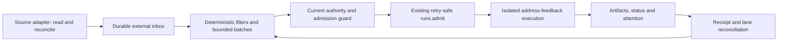

# Triggered workflows: feedback to an authorized agent

**Status: draft proposal for Casey and Cal; not approved for implementation or activation.**
Prepared 2026-10-03. No credentials, source connections, schedules, deployments or
runtime changes are created by this proposal. The proposed milestone has no due
date or release version. Its closure must not be used as an approval signal:
repository milestone closure invokes release preparation.

## Recommendation and product promise

Start with newly submitted human **CHANGES_REQUESTED** reviews on explicitly
enrolled, open, same-repository PRs in `cschadewitz/Project_Orca`. A daemon-side
read adapter periodically reconciles those reviews and their attached inline
comments. After a short bounded coalescing window, ORCA starts one fresh
`address-feedback` workflow in an isolated checkout at the verified PR head.
It produces local edits, test evidence and an addressed/unaddressed feedback
report. It does not reply on GitHub, push, open another PR, deploy or merge.

Unattended work is the normal path: an operator authorizes a narrow standing
trigger and execution profile once; matching feedback subsequently launches and
finishes ordinary read/edit/test work without a person clicking Start or approving
every batch. Operations outside that standing scope stop visibly for authorized
attention. External text never enlarges the standing scope. An agent that cannot
complete safely reports the limitation rather than pretending the task succeeded.

This is a recommendation, not an enabled default. Casey and Cal must resolve the
decisions below before implementation is authorized, and separately approve any
event-source enrollment or activation after acceptance evidence exists.

## Evidence baseline and overlap inventory

Inspected main is `3702da5b38dc449280c2837366615de741e9c45c` (PR [#415](https://github.com/cschadewitz/Project_Orca/pull/415)), fetched
2026-10-03. The starting worktree was older `7abc2342`; its missing-feature claims
were superseded by this inspection. Reviewed repository guidance:
[Contributing](../../../CONTRIBUTING.md),
[feature template](../../../.github/ISSUE_TEMPLATE/feature.md),
[development](../../DEVELOPMENT.md), [architecture](../../ARCHITECTURE.md),
[planning](../../PLANNING.md), [roadmap](../../ROADMAP.md),
[release behavior](../../RELEASING.md), and the runtime integration contracts.
The roadmap's 2026-10-01 snapshot and early paragraphs in feature handoff documents
are historical; actual main code and later integration evidence take precedence.
Merged implementation is not a claim that every parent issue's release or
actual-Cal acceptance is complete. Package version remains 0.6.0 on this main;
do not infer these integrated capabilities are all in a distributed release.

| Existing work | Current evidence and reuse | Remaining trigger-specific gap |
| --- | --- | --- |
| Event-sourced interpreter; [#97](https://github.com/cschadewitz/Project_Orca/issues/97), [#102](https://github.com/cschadewitz/Project_Orca/issues/102), [#196](https://github.com/cschadewitz/Project_Orca/issues/196), [#197](https://github.com/cschadewitz/Project_Orca/issues/197), [#267](https://github.com/cschadewitz/Project_Orca/issues/267) | Per-run JSONL ordering/recovery, document locks, fenced execution leases and artifact provenance in `packages/store` / `packages/engine` | External events need their own durable intake and routing lifecycle; a run notification is not a durable external queue |
| Dependency scheduling; [#74](https://github.com/cschadewitz/Project_Orca/issues/74), [#76](https://github.com/cschadewitz/Project_Orca/issues/76), [#170](https://github.com/cschadewitz/Project_Orca/issues/170) | Pure `schedule` plus plan dispatch, bounded fan-out and work-item claims; [planning](../../PLANNING.md) | An event wakeup is not a dependency scheduler; reuse dispatch only when a Request really needs decomposition |
| Auth [#328](https://github.com/cschadewitz/Project_Orca/issues/328); typed inputs [#330](https://github.com/cschadewitz/Project_Orca/issues/330); validation [#314](https://github.com/cschadewitz/Project_Orca/issues/314) | Merged [#368](https://github.com/cschadewitz/Project_Orca/pull/368)/[#364](https://github.com/cschadewitz/Project_Orca/pull/364)/[#370](https://github.com/cschadewitz/Project_Orca/pull/370)/[#371](https://github.com/cschadewitz/Project_Orca/pull/371); verified principals, operation/resource guards and workflow revision preflight | Explicit standing trigger delegation, repo/PR allowlist and constrained execution profile |
| Request submission [#329](https://github.com/cschadewitz/Project_Orca/issues/329), generations [#332](https://github.com/cschadewitz/Project_Orca/issues/332), live callbacks [#237](https://github.com/cschadewitz/Project_Orca/issues/237) | Merged [#381](https://github.com/cschadewitz/Project_Orca/pull/381)/[#384](https://github.com/cschadewitz/Project_Orca/pull/384)/[#383](https://github.com/cschadewitz/Project_Orca/pull/383) and [#397](https://github.com/cschadewitz/Project_Orca/pull/397); [runtime-next integration](../../runtime-next-integration.md) | No new Request service, config snapshot store or approval engine |
| Retry-safe admission [#331](https://github.com/cschadewitz/Project_Orca/issues/331) | Merged [#413](https://github.com/cschadewitz/Project_Orca/pull/413)/[#415](https://github.com/cschadewitz/Project_Orca/pull/415); `DirectAdmissionService`, `FileRetryClaimStore`, `runs.admit`, `admissions.get/reconcile`; production construction in CLI bootstrap and daemon methods | Map one immutable batch to one retained command/key/receipt; do not build another run-admission ledger |
| Continuations and revisions [#356](https://github.com/cschadewitz/Project_Orca/issues/356); MCP [#327](https://github.com/cschadewitz/Project_Orca/issues/327) | [#412](https://github.com/cschadewitz/Project_Orca/pull/412)/[#414](https://github.com/cschadewitz/Project_Orca/pull/414)/[#425](https://github.com/cschadewitz/Project_Orca/pull/425)/[#429](https://github.com/cschadewitz/Project_Orca/pull/429)/[#431](https://github.com/cschadewitz/Project_Orca/pull/431)/[#434](https://github.com/cschadewitz/Project_Orca/pull/434) incorporated through [#415](https://github.com/cschadewitz/Project_Orca/pull/415); [operator integration](../../runtime-operator-integration.md) | Existing exact-boundary operations are not arbitrary mid-turn feedback injection; v1 starts a fresh run |
| Workspaces [#139](https://github.com/cschadewitz/Project_Orca/issues/139) | `WorkspaceProvider` and built-in git worktrees | Current root runs without a work item can use the main checkout; require fresh attempt identity and pinned checkout before any agent turn |
| Store contract [#338](https://github.com/cschadewitz/Project_Orca/issues/338); SQLite [#339](https://github.com/cschadewitz/Project_Orca/issues/339) | Open contract/backend work, in milestone 12 | Put the contained external-intake consistency/conformance slice under [#338](https://github.com/cschadewitz/Project_Orca/issues/338); do not require all SQLite work for one local worker |
| Tracker contract/import/outbox [#348](https://github.com/cschadewitz/Project_Orca/issues/348)/[#349](https://github.com/cschadewitz/Project_Orca/issues/349)/[#350](https://github.com/cschadewitz/Project_Orca/issues/350) | Open, milestone 14; stable external identity, field ownership, reconciled import and publication | Review-to-run intake is distinct from importing planning items. Align identity and later reuse outbox; no new tracker sync or publisher |
| Scoped capabilities/secrets [#335](https://github.com/cschadewitz/Project_Orca/issues/335)/[#336](https://github.com/cschadewitz/Project_Orca/issues/336)/[#337](https://github.com/cschadewitz/Project_Orca/issues/337) | Open; manifests, secret references and negotiated session delivery | Reuse those owners for general capability delivery. V1 needs an enforceable fixed execution profile, not the whole capability catalog |
| Retention [#399](https://github.com/cschadewitz/Project_Orca/issues/399), recovery [#357](https://github.com/cschadewitz/Project_Orca/issues/357), history [#340](https://github.com/cschadewitz/Project_Orca/issues/340), performance [#408](https://github.com/cschadewitz/Project_Orca/issues/408)/[#423](https://github.com/cschadewitz/Project_Orca/issues/423) | Existing follow-ons | Reuse for generalized compaction/recovery/dashboard/performance; add only trigger status and reconciliation evidence |
| Known open defects [#443](https://github.com/cschadewitz/Project_Orca/issues/443) / PR [#448](https://github.com/cschadewitz/Project_Orca/pull/448); [#444](https://github.com/cschadewitz/Project_Orca/issues/444) / PR [#447](https://github.com/cschadewitz/Project_Orca/pull/447) | Continuation settlement race; startup-owned-session cleanup | Carry as acceptance dependencies where used; do not file duplicate bugs or claim the pending fixes merged |
| Beta feedback [#422](https://github.com/cschadewitz/Project_Orca/issues/422) / [#426](https://github.com/cschadewitz/Project_Orca/pull/426) | Human report/triage documentation | Not an event adapter or autonomous issue-processing pipeline |

The live inventory included all 82 open issues, relevant closed issues and the
150 most recent PRs, including every open PR at inspection. No existing issue
owned the full review-to-run outcome. Milestones 10 (safe Cal operation), 11
(workflow authoring), 12 (durable operations), 13 (fleet/usage), 14 (GitHub planning),
19/20 (context/peer collaboration), 21 (configuration/launch) and 22 (native Mac
beta) remain separate. No existing issue is moved, closed, relabeled or rescheduled.
The proposed milestone is an undated review bucket for new trigger work, not a
replacement release train. Existing foundations remain in their current milestones.

## First source and alternatives

| Option | Benefit | Cost and implication | Recommendation |
| --- | --- | --- | --- |
| Poll submitted PR reviews for enrolled PRs | Works with a private/local daemon; cohesive review boundary and stable review/comment IDs; no inbound endpoint | Detection delay and API budget; snapshots can miss short-lived deleted content | V1, with explicit snapshot semantics and bounded reconciliation |
| GitHub review webhooks | Lower latency; delivery identity; later shares the same normalized event envelope | Ingress/relay, signature verification, delivery retention and operational ownership | Later adapter, not a public daemon endpoint |
| Every issue/PR conversation comment | Captures informal feedback | Noisy, ambiguous target, more self-replies and fragmented instructions | Later explicit opt-in event family |
| Existing paused-run Request changes ([#356](https://github.com/cschadewitz/Project_Orca/issues/356)) | Exact intended next step and durable authorized correction | A human explicit operation, not unattended event ingestion; cannot revise a delivered prompt | Keep for operator intervention; no prerequisite for fresh-run v1 |
| Full GitHub tracker import [#349](https://github.com/cschadewitz/Project_Orca/issues/349) | Broad planning synchronization | Requires tracker mapping/storage work and imports unrelated work | Related future integration, not a v1 blocker |
| GitHub Actions starts ORCA remotely | Familiar event host | Adds authenticated network path and execution trust/secret concerns around PR code | Not the minimal private-daemon route |

GitHub provides separate review and review-comment APIs. A submitted review is
the batch root; its `commit_id` and attached comment IDs are evidence, not permission.
Use immutable repository/user/PR IDs; names and URLs are display metadata.
The adapter should need only the source-read permissions documented for those
endpoints. Exact credential type, permissions and rate behavior must be verified
in a future authorized setup; none is provisioned here.
[Reviews API](https://docs.github.com/en/rest/pulls/reviews),
[review comments API](https://docs.github.com/en/rest/pulls/comments).

Assumed v1 enrollment excludes forks, draft/closed PRs, bots and automation
identities. Human reviewers must be in an operator-configured ID allowlist, not
selected by body text or `author_association` alone. `APPROVED`, `COMMENTED`, pending
draft reviews and ordinary conversation comments are excluded initially. This
deliberately narrow choice needs Casey/Cal confirmation; it will miss useful
informal feedback. A poll can recover observable current state, not prove receipt
of feedback created and deleted between scans.

## Proposed architecture

These are logical responsibilities, not six new services. V1 is a daemon-owned
worker over one local store, with a cross-process fence so an accidentally started
second daemon cannot dispatch the same lane. It must run while the desktop is
closed; the current desktop-owned daemon exits with its window, so unattended
availability requires a separately supervised daemon in a later explicitly
authorized setup. No service installation is part of this proposal.

### Adapter and durable intake

Define a versioned adapter seam: enumerate enrolled targets, reconcile a bounded
page, fetch a review snapshot, normalize identity/provenance, report capability
limits and checkpoint only durably accepted observations. The adapter cannot pick
workflows, credentials or approval answers. The provider layer owns pagination,
conditional requests, rate limiting and source revision interpretation; core
routing owns neither GitHub URLs nor provider-specific payload fields.

An envelope carries schema version, provider/installation/repository identity,
native PR/review/comment IDs, event kind, actor ID/type, source timestamp/revision
when available, observed time, delivery ID if present, head SHA, payload reference
and digest, and trusted provenance. Preserve original and normalized versions.
Do not invent a provider sequence from timestamps or assume lexical IDs imply
ordering. Payloads are bounded untrusted data in protected storage; public logs
show safe correlation metadata, not reviewer prose or secret-bearing digests.

Use the existing protected-storage/key lifecycle and file locking. The intake
contract must name its authoritative record and durable boundary: normalized event
plus dedupe identity is durable before acknowledging a webhook or advancing a
poll checkpoint. Recover incomplete indexes from authoritative intake records.
No transaction is promised across source API, payload blob, cursor, batch and run.
Repeated pages are safe after a crash; payload publication before pointer failure
may leave an orphan, not a falsely accepted event. Full-store backup/restore follows
existing protected-state rules; a partial cursor-only restore is unsupported.

Proposed conservative bounds, subject to review: poll every 60 seconds with jitter,
at most 10 enrolled PRs, 100 reviews or 1,000 attached comments per PR scan, and
64 KiB canonical feedback per admitted batch. A page/cap failure preserves the
checkpoint and marks intake incomplete; it never silently truncates actionable
feedback. Oversize/incomplete targets need explicit narrowing or inspection.
Bootstrap snapshots existing review IDs as a durable baseline with **no backfill**;
optional historical replay requires a separate previewed user intent. A review
first observed after baseline is eligible, but edited historical reviews are
updated evidence, not automatically new work.

### Duplicates, stale observations and routing

Keep transport delivery identity separate from semantic identity
`(provider, installation, repositoryId, reviewId, observedRevisionDigest)`.
Webhook delivery IDs can repeat on redelivery; poll observations have no delivery
ID. Neither is the run idempotency key. Monotonic local observation versions track
changes without claiming provider-global order. Before batch sealing, refetch
current review state, attached comments, PR status and head. A stale delivery is
reconciled against authoritative current source state; no timestamp wins blindly.

Dismissed/deleted/inaccessible feedback is suppressed before dispatch, with a
tombstone/reason. After dispatch it cannot rewrite immutable inputs; mark the
result stale and require review. Polling cannot infer deletion from a partial page
or permission error. A changed head before admission supersedes the candidate;
only feedback verified against the newly selected head may form new intent.
Outdated review commit IDs are held as `needs-review` in v1, not silently rebased.

Routing is a declarative allowlist over trusted metadata: trigger enabled/version,
repository and PR enrollment, event/state, allowed human actor, current head,
origin and execution budget. No model chooses whether authority exists. It records
accepted/suppressed/held with stable reason codes, rule version and evidence IDs.

Per `(workspace, repositoryId, PR, triggerId)` lane, debounce for 60 seconds after
new eligible feedback with a five-minute maximum wait. Seal an immutable ordered
set of feedback identities/digests and head SHA into a batch. Deterministic ordering
is for reproducibility, not provider causality. At most one running batch and one
pending accumulator per lane; new feedback during execution belongs to the next
batch. Proposed workspace default is one active feedback run and three batches per
PR per day, with bounded queue capacity. Quota overflow is visible and retained
for review, never silent loss. No money/cost estimate is invented; future usage
budgets reuse [#345](https://github.com/cschadewitz/Project_Orca/issues/345)/[#346](https://github.com/cschadewitz/Project_Orca/issues/346).

### Standing authority and authorized admission

The operator authorizes a versioned `TriggerBinding` recording its owner principal,
dedicated execution principal, permitted repository/PR set, source actor allowlist,
workflow version/digest, configuration generation, input mapping, execution profile,
limits, credential references, expiry and approvers. New trigger administration
needs an explicit operation/resource policy; source or run-start authority does not
include editing the binding. Store trusted bindings outside agent-writable paths.

At sealing and immediately before admission, revalidate binding revision/enabled
state, principal and current grants, source-read access, target/head, workflow/input
preflight and required profile. Current resource authority is checked before private
diagnostics. Never substitute a local-owner credential after expiry. Use explicit
minimal grants for launch and owned result inspection; owned cancellation/control
only if the worker actually needs it. Do not use the broad `client` preset blindly:
it includes approval authority. Omit `inputs.answer`, `permissions.grant`, config
and plan writes from the autonomous dispatcher. Direct workflow admission avoids
creating a decomposed Request or asking for `plan.write` just to process one review.

A new admission requires the current `expectedConfigGeneration`. After
`config.apply` changes that generation, suspend new admissions until an authorized
operator reviews and updates the binding. Recovery of already admitted work retains
its original generation and never silently adopts current defaults.

Persist the exact validated command and opaque retry key derived from immutable
batch identity **before** calling existing `runs.admit`. Include verified expected
principal/workspace guards and pinned workflow/generation. Persist `operationId`,
admission/run IDs and receipt phase. Retry the same intent only with the same
command/key; use authorized inspection/reconciliation after an unknown response.
Never use legacy settled `runs.start` as a detached background-job queue. A changed
head, rule or workflow is a new explicit batch, not mutation under the old key.
An accepted receipt means admitted, not attached, completed or externally published.

Automatic Request/direct startup dispatch sweeps remain deferred on this main;
continuation startup recovery is a different path. The trigger worker must own a
bounded durable sweep of its accepted and ambiguous batch intents after restart,
using existing receipt inspection and explicitly authorized reconciliation rather
than assuming an in-memory launch callback survives. It rechecks the binding before
dispatch and reports any authority, ambiguity or storage refusal. Trigger recovery
owns its batch-to-receipt association, not a replacement admission journal.
The new lane fence must cover the decision to admit, disable/cancel races and
recovery publication. Since it cannot transact with run creation, a lost response
keeps the lane occupied until the original receipt is reconciled. Do not release
it on a timeout and start another run. Existing runtime lease loss stops stale
execution writers; it is not a substitute for the lane or retry ledger.

### Execution scope, approval and credential lifecycle

Launch authority, local-edit authority, test-code execution, external publication
and merging are distinct. The ordinary edit/test path must be preauthorized within
a reviewed execution profile; routine matching feedback should not park at a Start
gate. Profile violations fail closed or expose an exact existing approval request.
A feedback author saying “push this” supplies task text, never a publish grant.

Current `LocalHost.spawnAgent` inherits `process.env`. ACP permissions rely on agent
cooperation, and git worktrees share repository metadata. Neither is a security
sandbox. Before unattended edits are allowed, prove an execution boundary with an
allowlisted environment and filesystem/network scope: no daemon-owner/source-read/
GitHub publication credentials, credential helpers or unrelated home/config access;
trusted runtime/trigger policy/private storage inaccessible to the agent; only its
attempt workspace writable. Model access must use the selected narrowly scoped
execution identity, not inherit all daemon secrets. Read-only repository fetch and
workspace provisioning are trusted pre-execution actions. Disable untrusted hooks
and implicit submodule/dependency execution. Even an allowlisted `pnpm test` can run
repository-controlled code, so tests require the same confinement. If the selected
host/agent cannot enforce this profile, unattended activation is blocked; prompt
instructions alone do not satisfy acceptance. General secret-reference/catalog work
stays with [#335](https://github.com/cschadewitz/Project_Orca/issues/335)–[#337](https://github.com/cschadewitz/Project_Orca/issues/337); a fixed profile is the minimal v1 enforcement contract.

Existing authority checks guard attachment and invalidate live callbacks on
revocation. The execution signal is not a universal kill boundary for already
running or preauthorized agent actions. The trigger execution profile must enforce
and test its stop/cancellation boundary; it cannot undo prior effects or infer all
descendants stopped from a cancelled callback. Source credentials expiring stop
intake/checkpoint advance and new admission; already admitted local work remains
governed by execution authority. Execution credentials expiring block queued work
and request active cancellation through the trusted profile supervisor's owned
process-control channel. The expired dispatcher may no longer call `runs.cancel`:
never borrow a new owner credential. Test the supervisor stop path without that
credential, record incomplete stop honestly and retain the lane until reconciled.
Renewal is explicit, same-principal and current-
scope checked through existing recovery boundaries. A different principal cannot
adopt the run by presenting an old event. Do not silently refresh into broader
authority or record resolved secrets in batch provenance.

Durable workflow gates survive restart; live tool callbacks belong to their exact
daemon/session/turn/invocation. Existing [#237](https://github.com/cschadewitz/Project_Orca/issues/237) supports owner-local answers and
expires dead callbacks; cross-process callback forwarding is not implemented.
Show `awaiting-approval` or expired/owner-unavailable with the exact target and
authorized recovery path. The dispatcher never answers it itself, never uses
generic automatic gate selection, and never replays a prior tool approval into a
new invocation. Restart at a safe workflow boundary may require a fresh ask. Keep
standing permission writes separate from an explicit one-time answer.

### Feedback workflow and concurrency

Use trusted, pinned built-in nodes/templates to validate the frozen feedback,
inspect the pinned source, make a bounded local change, run approved validation and
emit artifacts. Do not launch `ai-sdlc` unchanged: it includes a deploy step and
automatic gate choices inappropriate to this scope. Inputs contain an opaque
protected feedback reference and verified target evidence, never source-selected
shell commands, paths, workflow IDs, agent choices or credential locators.

Extend the existing workspace seam for an isolated **root attempt**, rather than
assuming direct admission creates one. Identity must include batch/attempt, not
only a PR slug. `DirectAdmissionCommand` has no workspace override today: extend
trusted built-in provisioning and generation capture/binding; never smuggle a
source-selected path, SHA or provider through arbitrary workflow vars. Prefer a
built-in extension so custom-plugin restart restoration ([#394](https://github.com/cschadewitz/Project_Orca/issues/394)) is not silently
required. Provision from verified repository identity and pinned SHA; record
the path/branch association before starting the agent and recover the same attempt
after ambiguous provisioning. Never fall back to the shared checkout, reuse an
unrelated dirty directory or reset another run's work. Worktrees may be used only
inside the enforced execution boundary; use a separate clone if shared git metadata
cannot be protected. Agent commits are unnecessary for v1; preserve a diff artifact.

One PR lane prevents overlapping attempts on that PR; global capacity prevents
unbounded agents. Claims continue to own plan items where relevant and leases own
active interpreters. Two different PRs may run in parallel only after the configured
global limit permits and their execution workspaces are isolated. Feedback arriving
mid-run is never injected into the running prompt. A new run starts from current
verified source, not automatically from an earlier unpublished patch; show any
superseded proposal explicitly to avoid implying patches were combined.

Results include source review/comment IDs and snapshots, captured/current head,
addressed/unaddressed/needs-decision entries, changed files/diff artifact, actual test
commands/results and limits, run/attempt identity and policy/workflow provenance.
Validate required artifacts and report unsupported requests. No fabricated cost,
completion percentage or ETA. Initial reporting is through existing ORCA
run/artifact/attention interfaces and authorized Cal inspection; it does not depend
on adding GitHub comments or configuring a live Cal connection.

### Retries, cancellation and recovery

| Failure boundary | Required behavior |
| --- | --- |
| Fetch timeout, transient provider error or throttling | Bounded exponential backoff with jitter and provider retry guidance; keep checkpoint; surface exhausted/paused source |
| Permission revoked, malformed payload, unsupported target | No automatic retry storm; reasoned blocked/quarantined state and explicit remediation |
| Crash around intake/checkpoint/batch sealing | Replay authoritative intake and frozen memberships; re-read pages safely; no lost accepted event or duplicate batch |
| Admission timeout or catalog contention | Preserve exact key/command; inspect/reconcile original operation; bounded retry only for classified transient refusal, never claim acceptance from readable bytes alone |
| Missing private record, invalid key, generation mismatch or ambiguous workspace creation | Fail closed with original correlation; no new run or policy fallback |
| Agent/test failure | Existing bounded step retries within the same run; never reopen a trigger batch merely because the agent failed; explicit rerun has new attempt identity |
| Worker/daemon crash during execution | Existing authenticated history/lease/receipt recovery; ambiguous side effects require review, not blind re-execution; preserve workspace/artifacts |
| PR closed or head moved | Stop new dispatch, mark pending stale; request active cancellation under current authority, record if cancellation is incomplete; preserve evidence |
| Disable or cancel races with admission | Disable stops future/pending dispatch; explicit cancel records a tombstone and cancels an already admitted run once known; never resurrect automatically |
| Result publication/storage failure | Local result pending/failed distinct from run completion; reconcile artifacts; future external effects require durable separate outbox |

Disabling a trigger does not by itself cancel active work; a separate explicit
“disable and cancel” operation may do both with an audit trail. Cancellation cannot
undo edits or prove remote effects absent. Lane release requires terminal/reconciled
execution and recorded outcome, not a missing heartbeat. Recover abandoned lanes
under fencing; never break a live run lease or release a plan claim automatically.
Do not collect workspaces/private records needed for recovery. Initial event/dedupe
retention is conservative with explicit quotas and pause-at-capacity; compacting
payloads later must retain tombstones so old events/keys cannot become fresh work.
General retry-ledger compaction stays in [#399](https://github.com/cschadewitz/Project_Orca/issues/399).

### Loop prevention and observability

V1 accepts only enrolled human review submissions; replies, commits, pushes, status
checks and bot review identities are not trigger events. Explicitly exclude known
execution identities, even when using a human account. Shared human/automation
identity is ambiguous: hold it for review or require a distinct identity before
enrollment, rather than guessing from prose. No agent can edit its trusted rule.

Later publishers record effect IDs, native object IDs, execution identity and
causal parent in a durable outbox; source adapters join that trusted provenance
before routing. Text markers alone are forgeable. Bound causal depth, attempts and
daily lane activity; quarantine self/ancestor effects and replayed outputs. A person
quoting a bot is still untrusted task data and cannot override these filters.

Expose source health/last completed scan, checkpoint age, incomplete pages, received/
deduped/suppressed/held counts, queue age, next retry, batch membership, active lane,
receipt phase, run result, approval target, cancellation and recovery reason.
Use `source -> event -> rule version -> batch -> operation -> run -> artifact`
correlation. Trigger states are their own schema, not extra run statuses. Existing
run notifications drive the UI; source reconciliation belongs to the daemon worker,
not renderer polling. Logs/metrics use bounded safe metadata, not raw feedback or
secrets. Approval/credential failures must be discoverable without a healthy agent.

## Longer-term path

Preserve the envelope, immutable binding/batch, admission and result seams for
webhooks, issue feedback, CI failures, schedules or other providers. A verified
webhook receiver should durably queue before replying, validate signatures and
event/action allowlists, and feed the same reconciler; it does not expose the
daemon RPC to the internet. GitHub documents delivery IDs and redelivery behavior;
reconciliation remains necessary even with push delivery.
[Webhook practices](https://docs.github.com/en/webhooks/using-webhooks/best-practices-for-using-webhooks).

Only add multi-host consumption after store conformance/fencing supports it ([#338](https://github.com/cschadewitz/Project_Orca/issues/338),
[#339](https://github.com/cschadewitz/Project_Orca/issues/339), [#103](https://github.com/cschadewitz/Project_Orca/issues/103), [#342](https://github.com/cschadewitz/Project_Orca/issues/342)–[#344](https://github.com/cschadewitz/Project_Orca/issues/344)). Keep clock/event eligibility distinct from the plan's
dependency scheduler. Broader delegated capabilities reuse [#335](https://github.com/cschadewitz/Project_Orca/issues/335)–[#337](https://github.com/cschadewitz/Project_Orca/issues/337); richer
context/peer workflows reuse [#372](https://github.com/cschadewitz/Project_Orca/issues/372)–[#379](https://github.com/cschadewitz/Project_Orca/issues/379). Explicit feedback into a waiting run uses
[#356](https://github.com/cschadewitz/Project_Orca/issues/356)'s exact revision boundary; no generic live-prompt injection. Publication later
extends [#350](https://github.com/cschadewitz/Project_Orca/issues/350)'s conflict-safe outbox with separate policy, preview/approval where
required, stale-head checks and effect reconciliation; merging is yet another
authorized operation. A comment being delivered is not proof a patch merged.

## Decisions and research before implementation

| Owner decision | Recommendation | Evidence/research still needed |
| --- | --- | --- |
| Casey + Cal: first event family | Submitted CHANGES_REQUESTED reviews, including attached inline comments | Confirm informal COMMENTED reviews can wait; define eligible reviewer IDs and PR enrollment UX |
| Casey: standing authority and scope | Dedicated trigger execution identity; isolated local edits/tests, no publication | Choose enforceable host/agent profile and approved test/network/file boundaries; verify credential/helper exclusion |
| Casey + Cal: lifecycle | Fresh workflow per frozen batch; no history backfill; stale-head hold | Confirm unpublished-patch replacement and explicit rerun behavior |
| Casey + Cal: responsiveness/bounds | 60-second poll/debounce, five-minute maximum batch wait, one active run, three batches/PR/day | Measure API budget and burst patterns with offline fixtures; tune before activation |
| Casey: source and execution credential custody | Separate read adapter and execution identities with explicit renewal | Later authorized source permissions, token lifetime and unattended supervisor availability; no setup now |
| Cal: attention and result contract | ORCA artifacts plus exact actionable blocked reason | Verify bounded existing operator reads suffice; actual-Cal acceptance remains existing [#327](https://github.com/cschadewitz/Project_Orca/issues/327)/[#393](https://github.com/cschadewitz/Project_Orca/issues/393) |
| Casey + Cal: backlog approval | Proposed milestone and six slices below | Review dependencies, isolation scope and implementation ownership; no release date/version |

Research must also verify review pagination/edit/dismissal semantics, fork/force-push
handling, race-safe enrollment baseline, OS-specific filesystem durability and
process cleanup, safe repository fetch, adapter completeness limits and protected
payload sizing. Offline provider/agent fixtures come first. Any later live test
requires explicit setup authorization and an isolated enrolled test PR; this
proposal does not acquire access or operate one.

## Delivery plan and acceptance

The [proposed milestone](https://github.com/cschadewitz/Project_Orca/milestone/23)
contains only these six new issues, each with the primary
`ship-group:feedback-triggers` label and explicit review-pending status:

| Slice | Agent-ready issue | Hard prerequisites |
| --- | --- | --- |
| A | [#449: standing authority and enforced profile](https://github.com/cschadewitz/Project_Orca/issues/449) | None |
| B | [#450: intake consistency/conformance](https://github.com/cschadewitz/Project_Orca/issues/450), sub-issue of [#338](https://github.com/cschadewitz/Project_Orca/issues/338) | None; parentage is containment |
| C | [#451: read-only review adapter](https://github.com/cschadewitz/Project_Orca/issues/451) | [#450](https://github.com/cschadewitz/Project_Orca/issues/450) |
| D | [#452: batching and admission](https://github.com/cschadewitz/Project_Orca/issues/452) | [#449](https://github.com/cschadewitz/Project_Orca/issues/449), [#450](https://github.com/cschadewitz/Project_Orca/issues/450) and existing [#331](https://github.com/cschadewitz/Project_Orca/issues/331) contract |
| E | [#453: isolated feedback workflow](https://github.com/cschadewitz/Project_Orca/issues/453) | [#449](https://github.com/cschadewitz/Project_Orca/issues/449) |
| F | [#454: recovery/visibility/acceptance](https://github.com/cschadewitz/Project_Orca/issues/454) | [#451](https://github.com/cschadewitz/Project_Orca/issues/451), [#452](https://github.com/cschadewitz/Project_Orca/issues/452), [#453](https://github.com/cschadewitz/Project_Orca/issues/453) and existing [#444](https://github.com/cschadewitz/Project_Orca/issues/444) |

The independently verifiable boundaries are:

1. **A — Standing authority and enforced execution profile.** Binding policy and
   fixed-profile confinement. General capability catalogs remain [#335](https://github.com/cschadewitz/Project_Orca/issues/335)–[#337](https://github.com/cschadewitz/Project_Orca/issues/337).
2. **B — External-intake consistency and conformance.** A contained sub-issue of
   [#338](https://github.com/cschadewitz/Project_Orca/issues/338); no new generic store or SQLite migration.
3. **C — Read-only GitHub review adapter.** Depends on B for durable checkpoints.
4. **D — Router, bounded batches and retry-safe admission.** Depends on A/B and
   consumes existing [#331](https://github.com/cschadewitz/Project_Orca/issues/331); never duplicates admission.
5. **E — Isolated address-feedback workflow.** Depends on A; built-in workflow and
   workspace reuse with the missing root-attempt guarantee.
6. **F — Recovery, operator evidence and offline acceptance.** Depends on C/D/E
   and existing [#444](https://github.com/cschadewitz/Project_Orca/issues/444) for startup cleanup. [#443](https://github.com/cschadewitz/Project_Orca/issues/443) is related for the fresh-run v1;
   adopting replayed `runs.continue` as a recovery path makes its fix a hard gate.

A and B proceed independently after review. After their contracts are fixed, C,
D and E can run in parallel with exclusive file ownership; fixtures and failure
scenarios for F can be designed in parallel, final F acceptance follows integration.
B is a child of [#338](https://github.com/cschadewitz/Project_Orca/issues/338), not blocked by its own parent; completing B satisfies only
that subset of [#338](https://github.com/cschadewitz/Project_Orca/issues/338). No reverse dependency from [#338](https://github.com/cschadewitz/Project_Orca/issues/338) or existing runtime work is
introduced. Parentage is containment, not a scheduling edge. Follow existing
[#331](https://github.com/cschadewitz/Project_Orca/issues/331) blockers ([#329](https://github.com/cschadewitz/Project_Orca/issues/329)/[#328](https://github.com/cschadewitz/Project_Orca/issues/328)) as historical/ongoing acceptance ownership; do not demand
that broader milestone 10 close before using its merged services.

Before implementation begins, freeze one accepted base SHA and file ownership
contract. Authority owner A: binding policy, profile enforcement and stop lifecycle;
storage owner: intake seam/conformance only; adapter owner: provider
normalization; router owner: batch/lane admission; execution owner: workspace/profile
consumption, root-attempt provisioning and built-in workflow (E); integrator:
bootstrap, protocol and shared exports. A shared
ship group is not permission to modify another active story's files.

Acceptance is synthetic and failure-focused before any separately approved pilot:
duplicate/out-of-order delivery; interrupted pagination; baseline/restart; edited,
deleted, dismissed and stale-head reviews; source/auth expiry and same-principal
renewal; malicious body/URL/path/identity; own-review/reply/commit loops; bounded
coalescing and saturation; two workers and lane fencing; lost admission reply and
changed-key payload conflict; protected-store/fsync corruption; cancel-versus-admit;
new feedback mid-run; no shared-checkout mutation; prohibited filesystem/network/
credential access; held and expired live approvals; safe durable-gate recovery;
failed startup cleanup; and complete artifact reporting after restart. If the
implementation selects `runs.continue`, include [#443](https://github.com/cschadewitz/Project_Orca/issues/443)'s deterministic settlement
regressions before using that path.
Verify Node 22/24 and the selected execution host, preserving all current security,
coverage and durability gates. Runtime checks belong to future implementations;
this documentation-only PR validates links, backlog graph, formatting and scope.
