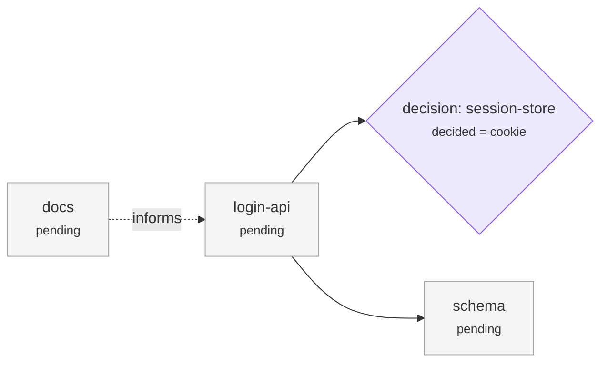

# Schedule for plan `demo`

Computed 2026-11-21T04:08:26.424Z with strategy **critical-path** (risk appetite: high).

## Ready (dispatch order)

1. `schema` (score 7.6) - unblocks 1 item (login-api); on the critical path (length 3); exposed to medium risk: migration-downtime
2. `docs` (score 1.5)

## Waiting

- `login-api`: waiting for schema to be done (currently pending)

## Waves

1. `schema`, `docs`
2. `login-api`

Critical path (3): `schema` -> `login-api`

## Risks

| risk | level | L x I | status | affects | mitigation |
| --- | --- | --- | --- | --- | --- |
| migration-downtime | medium | 2 x 4 | open | schema | Run the migration online |
| token-leak | high | 2 x 5 | open | login-api | Redact in logger |

## Decisions

### session-store: Where do sessions live? (decided = cookie)

Signed cookies or a server-side store?

| option | Simplicity (w3) | Revocation support (w1) | score |
| --- | --- | --- | --- |
| **Signed cookie** | 9 | 3 | 7.5 |
| Redis | 5 | 9 | 6 |

Recommended: **cookie** (clear, margin 0.15); pivotal criteria: simplicity

Rationale: Simplicity wins for v1.

Blocks: login-api

## Dependency graph

